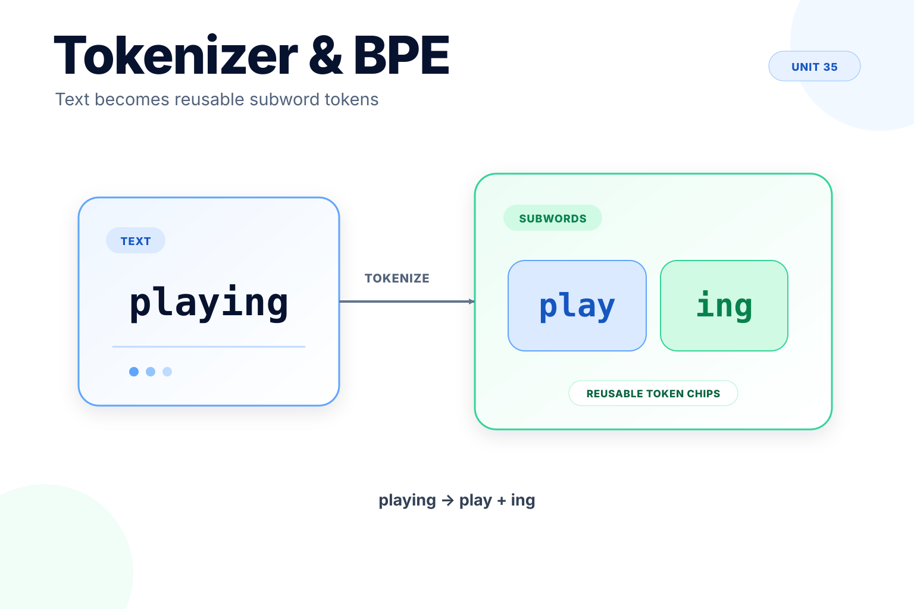
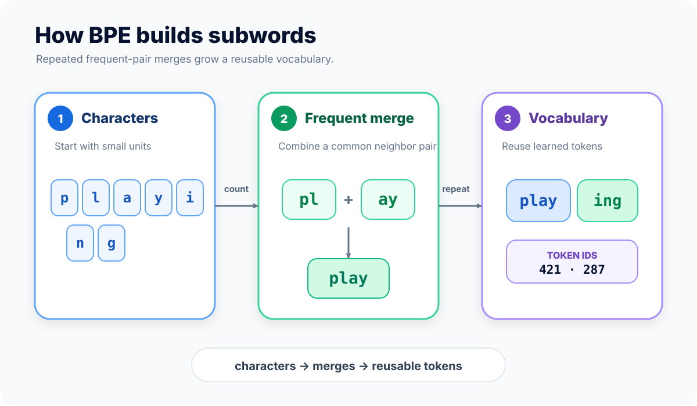
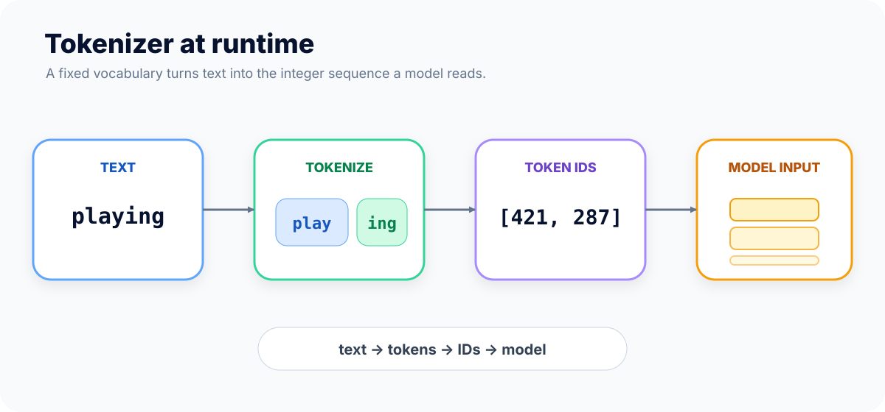

# Unit 35: TokenizerとBPEの基礎

<p class="unit-hero">
  
</p>

> [!NOTE]
> このUnitは第4章の **LLM内部とモデル適応 (Unit 35〜36)** トラックに位置づけられ、LLMが文章をToken IDへ変換する流れを小さなBPEの例とToken数の影響から理解します（大規模モデルや実用Tokenizerを訓練する内容ではありません）。
>
> - **位置づけ・前提** : [Unit 22（LLMからAIエージェントへの進化）](../unit22_llm_evolution/index.md) と [Unit 23（LLM API の利用とプロンプトエンジニアリング）](../unit23_llm_api/index.md) が前提です。RAGのチャンク分割に入る前にトークン数の仕組みを押さえたい場合は、Unit 23 の直後に先取りして学習できます。
> - **次のステップ** : [Unit 36（LoRA / QLoRAによるLLM適応の基礎）](../unit36_lora_qlora/index.md) へ進んだのち、[第5章の総合演習（Unit 37〜）](../unit37_llm_harness_capstone/index.md) に取り組みます。

## 1. TokenizerとBPEの理解

> Unit 23では、モデル付属のTokenizer（`tiktoken`）を呼び出して実際のToken数を測定しました。このUnitでは、その内部を完全に再現するのではなく、頻出ペアのマージというBPEの中心的な考え方だけを小さな実装で確認します。

LLMは文章をそのまま受け取らず、Tokenという小さな単位へ分割してから整数のToken IDに変換します。単語単位ではなく、頻出する文字列のまとまり（サブワード）を使うことで、未知の単語や日本語、コードも扱いやすくします。

### BPEの基本的な考え方

Byte Pair Encoding（BPE）は、最初に文字やバイトを単位にし、データ中で頻出する隣接ペアを順番に結合してVocabularyを作る考え方です。実際のLLMでは実装やVocabularyが異なるため、ここで作る小さなTokenizerの結果をそのまま実用Tokenizerの結果とみなしてはいけません。

下図は、文字単位から頻出ペアを結合し、再利用できるVocabularyを作る中心概念です。



Token数はモデルのコンテキスト長、API料金、推論時間に関係します。同じ文字数でも言語や表現によってToken数が変わるため、LLMアプリケーションでは実際のTokenizerで測定することが重要です。

下図は、学習済みVocabularyを使うTokenizer実行時の流れです。



## 2. 実装例 (Implementation Example)

まずは外部ライブラリを使わず、頻出ペアを結合する最小のBPE風アルゴリズムを実装します。

```python
from collections import Counter


def pair_counts(tokens):
    return Counter(zip(tokens, tokens[1:]))


def merge_pair(tokens, pair):
    merged = []
    i = 0
    while i < len(tokens):
        if i < len(tokens) - 1 and (tokens[i], tokens[i + 1]) == pair:
            merged.append(tokens[i] + tokens[i + 1])
            i += 2
        else:
            merged.append(tokens[i])
            i += 1
    return merged


def train_toy_bpe(words, merges=3):
    tokens = [list(word) + ["</w>"] for word in words]
    for _ in range(merges):
        counts = Counter()
        for word_tokens in tokens:
            counts.update(pair_counts(word_tokens))
        if not counts:
            break
        best_pair, frequency = counts.most_common(1)[0]
        if frequency < 2:
            break
        tokens = [merge_pair(word_tokens, best_pair) for word_tokens in tokens]
        print("merge:", best_pair, "frequency:", frequency)
    return tokens


corpus = ["playing", "played", "player", "playing"]
print(train_toy_bpe(corpus))
```

この例は学習用の簡略版です。実際のTokenizerには正規化、特殊Token、Unicode、Vocabulary保存、未知入力の扱いなどが加わります。

## 3. 実践 (Practice)

次のスターターデータ（英語・日本語・Pythonコード各3文）を使って、toy BPEの結合回数による変化と、実用Tokenizer（`tiktoken`）との違いを観察してください。

```python
samples = {
    "english": [
        "Tokenizers split text into subword tokens.",
        "Byte pair encoding merges frequent token pairs.",
        "Counting tokens helps estimate context length and cost.",
    ],
    "japanese": [
        "トークナイザーは文章をサブワードのトークンに分割します。",
        "BPEは頻出する文字ペアを順番に結合して語彙を作ります。",
        "トークン数を測定すると、コンテキスト長と料金を見積もれます。",
    ],
    "python": [
        "def count_tokens(tokens):\n    return len(tokens)",
        "def merge_tokens(tokens, pair):\n    return [t for t in tokens if t]",
        "total_tokens = sum(count_tokens(item) for item in batch)",
    ],
}
```

### 取り組む手順

1. **Step 1: `train_toy_bpe` で結合回数（`merges=3` と `merges=10`）を比較する**
   - セクション2の `train_toy_bpe` を使い、`samples` の各カテゴリ（`english`・`japanese`・`python`）について `merges=3` と `merges=10` で実行してください。
   - 各文を `text.split()` で分割して渡し、合計Token数の変化と、どのようなサブワードへまとまったかを確認します。
2. **Step 2: 同じデータで実用Tokenizer（`tiktoken`）のToken数を測定する**
   - Unit 23で扱った `tiktoken` を使い、`tiktoken.encoding_for_model("gpt-4o-mini")`（または `tiktoken.get_encoding("o200k_base")`）で同じ `samples` のToken数を測定してください。
   - カテゴリごとに「合計文字数」と「合計Token数」を並べて比較します。
   - Google Colabでは通常 `tiktoken` が利用できますが、未インストールの環境で `ModuleNotFoundError` が出る場合は、セルの先頭で `%pip install tiktoken` を実行してから試してください。
3. **Step 3: toy BPEと実用Tokenizerの結果が異なる理由を3つ説明する**
   - Step 1とStep 2の結果を見比べ、同じテキストを入力しても分割結果やToken数が大きく異なる理由を、仕組みの違いに基づいて3つ具体的に説明してください。

## 4. 答え合わせ (Answer Key)

<details>
<summary>解答例を見る（クリックで展開）</summary>

```python
from collections import Counter


def pair_counts(tokens):
    return Counter(zip(tokens, tokens[1:]))


def merge_pair(tokens, pair):
    merged = []
    i = 0
    while i < len(tokens):
        if i < len(tokens) - 1 and (tokens[i], tokens[i + 1]) == pair:
            merged.append(tokens[i] + tokens[i + 1])
            i += 2
        else:
            merged.append(tokens[i])
            i += 1
    return merged


def train_toy_bpe(words, merges=3, verbose=False):
    tokens = [list(word) + ["</w>"] for word in words]
    for step in range(1, merges + 1):
        counts = Counter()
        for word_tokens in tokens:
            counts.update(pair_counts(word_tokens))
        if not counts:
            break
        best_pair, frequency = counts.most_common(1)[0]
        if frequency < 2:
            break
        tokens = [merge_pair(word_tokens, best_pair) for word_tokens in tokens]
        if verbose:
            print(f"  merge {step}: {best_pair} (freq={frequency})")
    return tokens


samples = {
    "english": [
        "Tokenizers split text into subword tokens.",
        "Byte pair encoding merges frequent token pairs.",
        "Counting tokens helps estimate context length and cost.",
    ],
    "japanese": [
        "トークナイザーは文章をサブワードのトークンに分割します。",
        "BPEは頻出する文字ペアを順番に結合して語彙を作ります。",
        "トークン数を測定すると、コンテキスト長と料金を見積もれます。",
    ],
    "python": [
        "def count_tokens(tokens):\n    return len(tokens)",
        "def merge_tokens(tokens, pair):\n    return [t for t in tokens if t]",
        "total_tokens = sum(count_tokens(item) for item in batch)",
    ],
}

# Step 1: toy BPE で merges=3 と merges=10 を比較
# （train_toy_bpe(..., verbose=True) とすると各マージ手順も確認できます）
toy_results = {}
print("=== Step 1: toy BPE (merges=3 vs merges=10) ===")
for lang, texts in samples.items():
    words = [word for text in texts for word in text.split()]
    tokens_m3 = train_toy_bpe(words, merges=3)
    tokens_m10 = train_toy_bpe(words, merges=10)
    total_chars = sum(len(text) for text in texts)
    count_m3 = sum(len(word_tokens) for word_tokens in tokens_m3)
    count_m10 = sum(len(word_tokens) for word_tokens in tokens_m10)
    toy_results[lang] = (total_chars, count_m3, count_m10)

    first_word_count = len(texts[0].split())
    print(
        f"[{lang}] chars={total_chars}, "
        f"toy_bpe(merges=3)={count_m3}, toy_bpe(merges=10)={count_m10}"
    )
    print(f"  1文目の分割例 (merges=3):  {tokens_m3[:first_word_count]}")
    print(f"  1文目の分割例 (merges=10): {tokens_m10[:first_word_count]}")

# Step 2: 実用 Tokenizer (tiktoken) で同じ文章の Token 数を測定
print("\n=== Step 2: 実用 Tokenizer (tiktoken) との比較 ===")
try:
    import tiktoken
except ImportError:
    print(
        "tiktoken がインストールされていません。"
        "Colab やローカル環境で `%pip install tiktoken` を実行してから再実行してください。"
    )
    tiktoken = None

if tiktoken is not None:
    try:
        try:
            encoding = tiktoken.encoding_for_model("gpt-4o-mini")
        except KeyError:
            encoding = tiktoken.get_encoding("o200k_base")
    except Exception as exc:
        print(
            "tiktoken のエンコーディングを取得できませんでした"
            f"（オフライン環境など）: {exc}"
        )
        encoding = None

    if encoding is not None:
        print(f"使用エンコーディング: {encoding.name}")
        for lang, texts in samples.items():
            total_chars, count_m3, count_m10 = toy_results[lang]
            per_sentence = [len(encoding.encode(text)) for text in texts]
            total_tiktoken = sum(per_sentence)
            chars_per_token = total_chars / total_tiktoken
            print(
                f"[{lang}] chars={total_chars}, "
                f"toy_bpe(3)={count_m3}, toy_bpe(10)={count_m10}, "
                f"tiktoken={total_tiktoken} (文別: {per_sentence}, "
                f"約 {chars_per_token:.2f} 文字/Token)"
            )
```

### 解説

- **結合回数とToken数の関係**: `merges=3` から `merges=10` へ増やすと、英語の `oken`→`token`、日本語の `トー`→`トーク`→`トークン` や `ます。`、Pythonの `to`→`tok`→`token`→`tokens` や `_tokens(` のように頻出する文字列が長いサブワードへまとまり、Token数は減少します。
- **なぜ「Token数 ≠ 文字数」なのか**:
  - 英語では頻出単語や接辞が1 Tokenにまとまりやすく、文字数よりToken数が大幅に少なくなります。
  - 日本語はUTF-8で1文字あたり3バイトを占める文字が多く、語彙に登録されていない漢字や表現は複数バイトに分割されるため、同じ文字数でも英語よりToken数が増えやすい傾向があります。
  - Pythonコードはインデント用の空白、改行、記号（`(`, `)`, `:`, `_`）、変数名の頻度によって分割数が変わるため、文字数だけではAPI料金やコンテキスト消費量を正確に見積もれません。
- **toy BPEと実用Tokenizerの結果が異なる主な理由**:
  1. **学習コーパスの規模と多様性**: toy BPEは手元の3文だけから頻出ペアを数えますが、実用Tokenizerは多言語テキストやソースコードを含む大規模コーパスから統計的にサブワード語彙を構築しています。
  2. **正規化と事前分割**: 実用TokenizerはBPE結合の前に正規表現パターンなどで単語境界・数字・記号・改行を適切に切り分け、必要に応じてUnicode正規化も行います（toy BPEは単純な `split()` のみです）。
  3. **UTF-8バイトレベルBPE**: `tiktoken` などの実用Tokenizerは文字単位ではなくUTF-8バイト列を基本単位にすることで、未知語（UNK）を出さずにあらゆるUnicode文字や絵文字を表現できます。
  4. **空白と特殊Tokenの扱い**: 実用Tokenizerは語頭のスペースやインデントもTokenに含めて元のテキストを復元できるように設計され、さらに `<|endoftext|>` のような特殊Tokenも管理します（toy BPEの `</w>` とは設計が異なります）。
  5. **Vocabularyサイズ**: toy BPEの結合回数は数回ですが、`o200k_base` のような実用エンコーディングは約20万語彙を持つため、頻出語や定型表現をはるかに少ないToken数へ圧縮できます。

Token数は文字数に単純比例しません。実務では、日本語・英語・コードを実際に利用するモデル対応のTokenizerで測定し、コンテキスト長の上限とAPI費用を見積もることが重要です。

</details>
