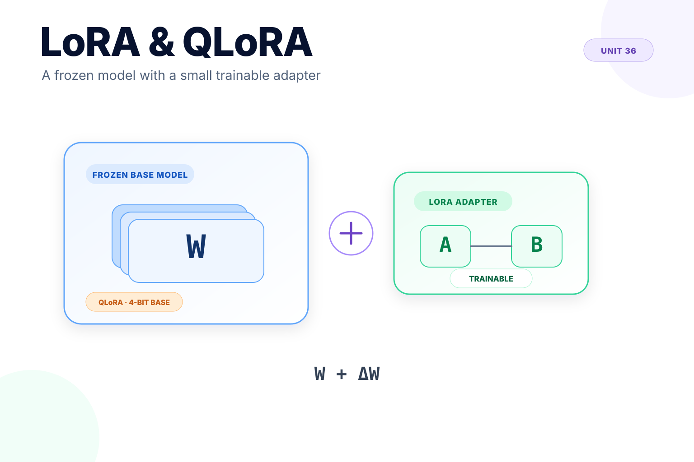
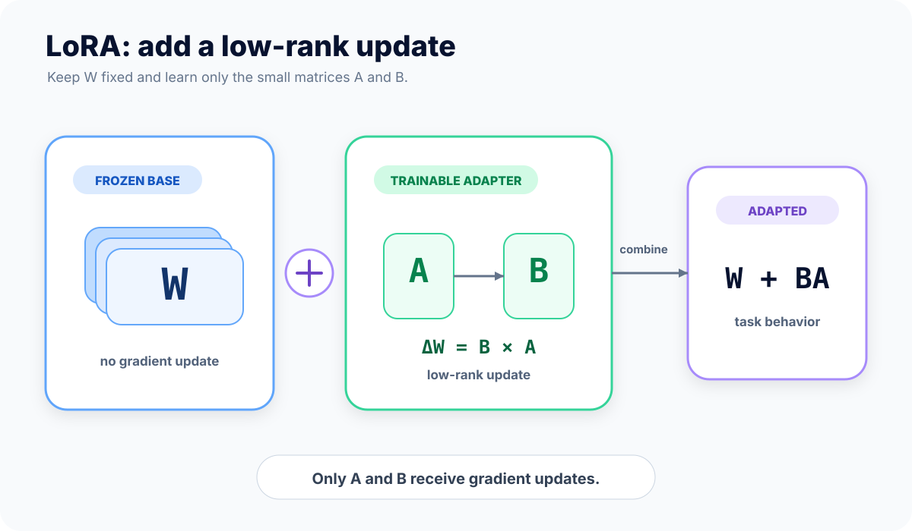
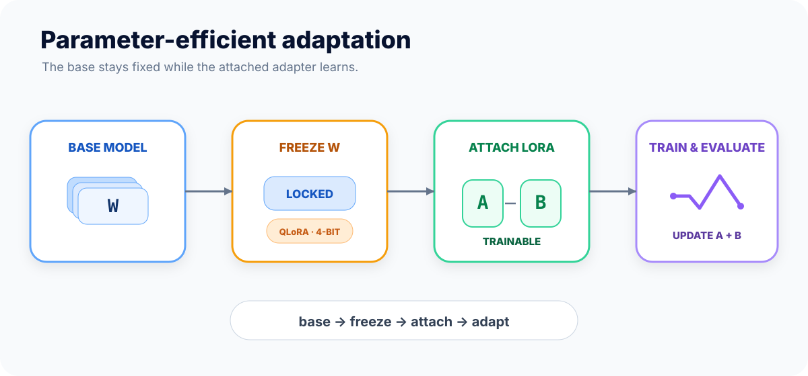

# Unit 36: LoRA / QLoRAによるLLM適応の基礎

<p class="unit-hero">
  
</p>

> [!NOTE]
> このUnitは第4章の **LLM内部とモデル適応 (Unit 35〜36)** トラックの最終ユニットです。凍結したベースモデルに小さな低ランクアダプターを追加するLoRAの仕組みと、QLoRAの設計トレードオフを最小実装で確認します。
>
> - **位置づけ・前提** : [Unit 15（ResNet を用いた転移学習）](../unit15_transfer_learning/index.md) と [Unit 20（注意機構と Transformer）](../unit20_attention_transformers/index.md)〜[Unit 23（LLM API の利用とプロンプトエンジニアリング）](../unit23_llm_api/index.md) の理解を土台にします（[Unit 35（TokenizerとBPEの基礎）](../unit35_tokenizer_bpe/index.md) とあわせてモデル内部の基礎を固めます）。
> - **次のステップ** : 第4章の締めくくりとして、[第5章の総合演習（Unit 37〜）](../unit37_llm_harness_capstone/index.md) へ進みます。

> [!WARNING]
> 学習データに個人情報や秘密情報を含めないでください。モデルとデータのライセンス、GPU費用、評価用データの分離も確認します。

## 1. ファインチューニングとLoRAの理解

LLMのファインチューニングは、既存モデルの重みをタスクやドメインに合わせて調整する方法です。全パラメータを更新するとGPUメモリと保存容量が大きくなるため、LoRA（Low-Rank Adaptation）は元の重みを凍結し、小さな低ランク行列だけを学習します。

概念的には、元の線形変換`W`に、学習する更新量`ΔW = B × A`を加えます。LoRAは学習対象を減らせますが、品質・安全性・ライセンスの問題を自動的に解決するものではありません。

QLoRAは、量子化したベースモデルにLoRAを組み合わせる方法です。少ないメモリで学習できる可能性がありますが、4-bit量子化の実装、GPU、ライブラリの組み合わせに依存します。本UnitではまずLoRAの仕組みを小さなモデルで確認し、QLoRAは設計上の違いと注意点を学びます。

下図は、凍結したベース重み`W`に、学習可能な低ランク更新`B × A`を加えるLoRAの構造です。



下図は、ベースモデルを凍結し、必要に応じて量子化してからLoRAアダプターを取り付け、学習・評価する流れです。



## 2. 実装例 (Implementation Example)

PyTorchだけでLoRAの更新を確認します。これは仕組みを理解するための最小例で、実際のLLMを学習するコードではありません。

```python
import torch
from torch import nn


class LoRALinear(nn.Module):
    def __init__(self, in_features, out_features, rank=2, alpha=1.0):
        super().__init__()
        self.base = nn.Linear(in_features, out_features)
        for parameter in self.base.parameters():
            parameter.requires_grad = False
        self.adapter_a = nn.Parameter(torch.randn(rank, in_features) * 0.01)
        self.adapter_b = nn.Parameter(torch.zeros(out_features, rank))
        self.scale = alpha / rank

    def forward(self, x):
        base_output = self.base(x)
        update = (x @ self.adapter_a.T) @ self.adapter_b.T
        return base_output + self.scale * update


model = LoRALinear(8, 4, rank=2)
trainable = sum(p.numel() for p in model.parameters() if p.requires_grad)
total = sum(p.numel() for p in model.parameters())
print("trainable parameters:", trainable)
print("total parameters:", total)
```

`base`の重みは更新されず、`adapter_a`と`adapter_b`だけが学習対象です。実際のLLMでは、PEFTなどのライブラリを使い、対象層、学習率、ランク、評価方法を設計します。

## 3. 実践 (Practice)

セクション 2 で定義した `LoRALinear` を使い、小規模な合成回帰データ上で LoRA のパラメータ削減と凍結の挙動を確認しましょう。まずは次のセットアップで入力 `X` と正解 `y` を用意してください。

```python
import torch
from torch import nn

torch.manual_seed(42)
in_features = 16
out_features = 8
X = torch.randn(64, in_features)
true_weight = torch.randn(in_features, out_features) * 0.5
y = X @ true_weight + 0.1 * torch.randn(64, out_features)
```

次の順番で実験と考察を行ってください。

1. `rank in [1, 2, 4]` のループを回し、各 `rank` における学習対象パラメータ数、総パラメータ数、および全パラメータ更新の `nn.Linear(16, 8)` と比較した学習対象パラメータの割合を表示する。
2. `all(not p.requires_grad for p in model.base.parameters())` を使い、ベース層のパラメータがすべて凍結されていることを確認する。
3. 学習前に `model.base.weight`（および `adapter_a` / `adapter_b`）を `.detach().clone()` で保存し、学習対象パラメータのみを `torch.optim.Adam` に渡して `nn.MSELoss()` で 20 ステップ学習する。学習後に `torch.allclose` を使って `base.weight` が完全に不変である一方、`adapter_a` と `adapter_b` が変化し、損失（Loss）が減少したことを検証する。
4. QLoRA について、量子化によるメモリ削減の利点と、精度・学習速度・GPU / ライブラリ依存性のトレードオフを説明する。

本番モデルを学習する場合は、訓練データと評価データを分離し、元モデル、アダプター、Tokenizer、学習設定、評価結果を記録してください。

## 4. 答え合わせ (Answer Key)

<details>
<summary>解答例を見る（クリックで展開）</summary>

```python
import torch
from torch import nn


class LoRALinear(nn.Module):
    def __init__(self, in_features, out_features, rank=2, alpha=1.0):
        super().__init__()
        self.base = nn.Linear(in_features, out_features)
        for parameter in self.base.parameters():
            parameter.requires_grad = False
        self.adapter_a = nn.Parameter(torch.randn(rank, in_features) * 0.01)
        self.adapter_b = nn.Parameter(torch.zeros(out_features, rank))
        self.scale = alpha / rank

    def forward(self, x):
        base_output = self.base(x)
        update = (x @ self.adapter_a.T) @ self.adapter_b.T
        return base_output + self.scale * update


# 再現性のためのシード固定と小規模な合成回帰データの作成
torch.manual_seed(42)
in_features = 16
out_features = 8
X = torch.randn(64, in_features)
true_weight = torch.randn(in_features, out_features) * 0.5
y = X @ true_weight + 0.1 * torch.randn(64, out_features)

# ステップ 1: rank ごとのパラメータ数を全パラメータ更新の nn.Linear と比較する
full_layer = nn.Linear(in_features, out_features)
full_trainable = sum(p.numel() for p in full_layer.parameters() if p.requires_grad)
print(
    f"Full nn.Linear({in_features}, {out_features}): "
    f"trainable={full_trainable} (100.0%)"
)

for rank in [1, 2, 4]:
    lora_layer = LoRALinear(in_features, out_features, rank=rank, alpha=float(rank))
    trainable = sum(p.numel() for p in lora_layer.parameters() if p.requires_grad)
    total = sum(p.numel() for p in lora_layer.parameters())
    trainable_pct = trainable / total * 100
    vs_full_pct = trainable / full_trainable * 100
    print(
        f"LoRA rank={rank}: trainable={trainable}, total={total}, "
        f"trainable/total={trainable_pct:.1f}%, vs_full={vs_full_pct:.1f}%"
    )

# ステップ 2: ベース層のパラメータがすべて凍結されていることを確認する
model = LoRALinear(in_features, out_features, rank=4, alpha=4.0)
base_all_frozen = all(not p.requires_grad for p in model.base.parameters())
print("base parameters all frozen:", base_all_frozen)
assert base_all_frozen

# ステップ 3: 学習前後の重み変化と損失の減少を検証する
base_weight_before = model.base.weight.detach().clone()
adapter_a_before = model.adapter_a.detach().clone()
adapter_b_before = model.adapter_b.detach().clone()

criterion = nn.MSELoss()
trainable_params = [p for p in model.parameters() if p.requires_grad]
optimizer = torch.optim.Adam(trainable_params, lr=0.05)

with torch.no_grad():
    initial_loss = criterion(model(X), y).item()

for step in range(20):
    optimizer.zero_grad()
    predictions = model(X)
    loss = criterion(predictions, y)
    loss.backward()
    optimizer.step()

with torch.no_grad():
    final_loss = criterion(model(X), y).item()

base_unchanged = torch.allclose(base_weight_before, model.base.weight)
adapter_a_changed = not torch.allclose(adapter_a_before, model.adapter_a)
adapter_b_changed = not torch.allclose(adapter_b_before, model.adapter_b)

print(f"initial_loss={initial_loss:.4f} -> final_loss={final_loss:.4f}")
print("base.weight unchanged:", base_unchanged)
print("adapter_a changed:", adapter_a_changed)
print("adapter_b changed:", adapter_b_changed)

assert base_unchanged
assert adapter_a_changed
assert adapter_b_changed
assert final_loss < initial_loss
```

### 解説

- **ランク (`rank`) のトレードオフ** : `LoRALinear(16, 8)` の学習対象パラメータ数は `(16 + 8) × rank` であり、`rank=1, 2, 4` ではそれぞれ 24 個、48 個、96 個となります（全パラメータ更新の `nn.Linear(16, 8)` は重み 128 + バイアス 8 = 136 個）。ランクを大きくすると表現力は増えますが、学習対象パラメータ数・メモリ消費・学習時間・過学習リスクも増えます。今回の小さな層では削減幅が小さく見えても、実際の LLM（例：4096×4096 の層）では低ランク近似により学習対象を元の 1% 未満まで抑えられます。
- **`adapter_b` をゼロ初期化する理由** : `adapter_a` を小さな乱数、`adapter_b` をゼロで初期化しておくと、学習開始時（ステップ 0）には `ΔW = B × A = 0` になります。これにより、学習直前の出力が事前学習済みベースモデルの出力と完全に一致し、元の知識を壊さずに安定した状態から適応を始められます（1 ステップ目で `adapter_b` が更新され、2 ステップ目以降は `adapter_a` にも勾配が流れて両方が更新されます）。
- **QLoRA の利点とトレードオフ** : QLoRA は「LoRA なら必ず量子化される」という意味ではなく、量子化（例：4-bit）したベースモデルを凍結し、その上に LoRA アダプターを組み合わせて学習する構成です。ベース重みが占める GPU メモリを大幅に削減できるため、限られた VRAM でも大規模モデルを扱いやすくなります。一方、計算時の逆量子化に伴う学習速度の低下、量子化誤差による精度への影響、さらに対応する量子化ライブラリ（bitsandbytes など）や GPU・CUDA 環境への依存性が高まる点がトレードオフです。

</details>
