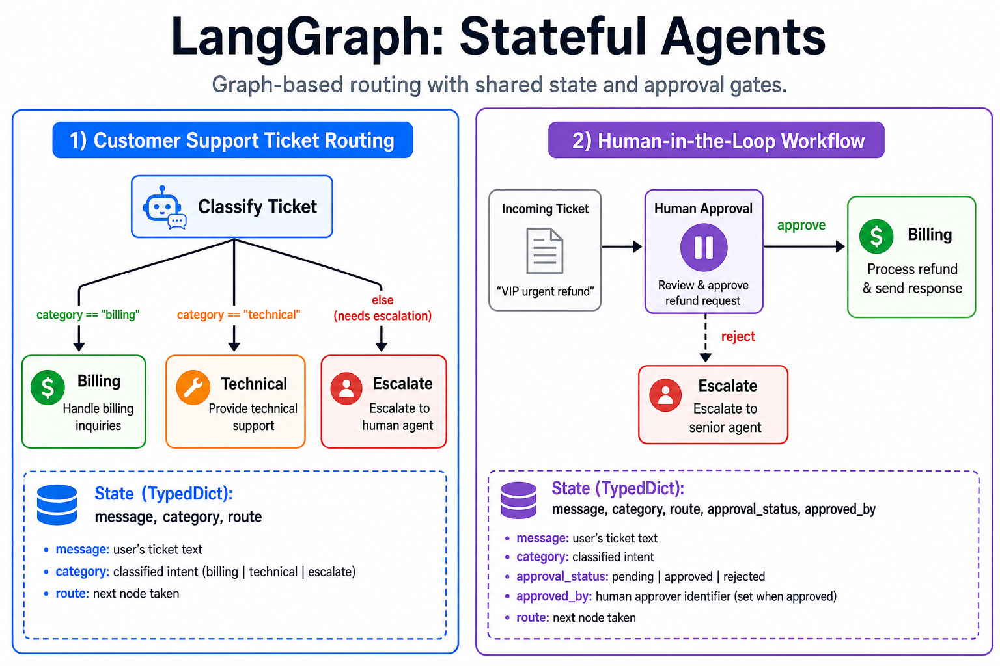
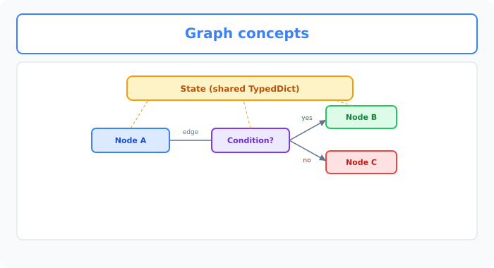
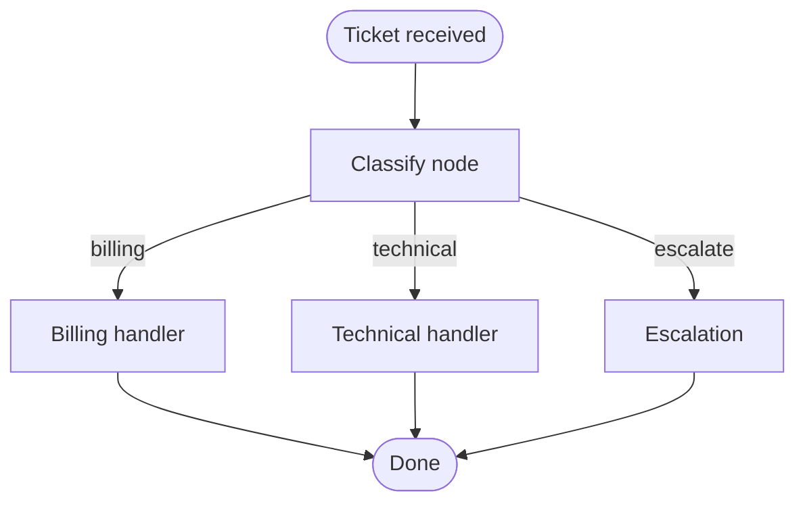
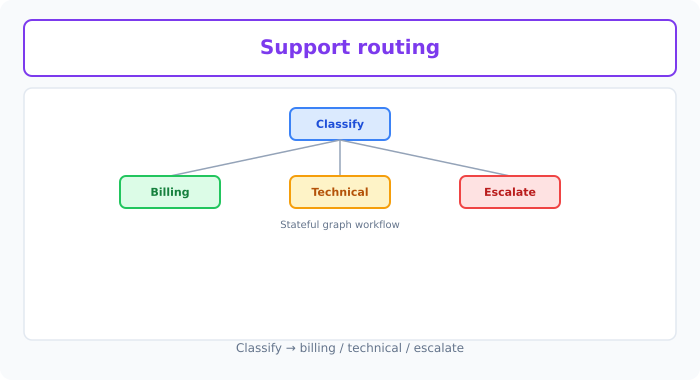

# Unit 32: LangGraph — Graph-Based Stateful Agents

<p class="unit-hero">
  
</p>

In Unit 31 you learned **code-generation agents (Code Agent)** with smolagents. This unit introduces a different paradigm: **graph-based workflow control**. LangGraph lets you explicitly design agent logic as **nodes** and **edges**, passing **shared state** between steps so you can incorporate conditional branching and **human-in-the-loop** approval gates cleanly.


## 1. Understanding LangGraph and Stateful Workflows

> This chapter uses the Python type hints `TypedDict` and `Literal` to describe state shape and branch targets. Comments in the code explain their roles so you can follow the implementation even if you are new to type hints.

### 1.1 Why a graph?

Unit 29’s ReAct loop uses **implicit control flow inside a while loop**. Unit 31’s smolagents focuses on **executing LLM-written Python**. In business systems, however, the following requirements appear frequently:

- **Explicitly branch** the workflow path based on classification results
- Insert **human approval** only for high-priority or VIP cases
- **Persist intermediate state** so workflows can resume later

LangGraph models these requirements as a **directed graph**.

| Concept   | Role                                                | Everyday analogy                  |
| :-------- | :-------------------------------------------------- | :-------------------------------- |
| **State** | Shared data passed between nodes (dict / TypedDict) | A support “ticket record”         |
| **Node**  | A processing unit that reads and updates state      | “Classify”, “hand off to billing” |
| **Edge**  | Transition that determines the next node to run     | “If billing → Billing node”       |

The diagram below illustrates LangGraph’s core graph building blocks: **State / Node / Edge**.



### 1.2 Comparison with smolagents (Code Agent)

| Axis                      | smolagents (Code Agent)                | LangGraph (Graph Workflow)                    |
| :------------------------ | :------------------------------------- | :-------------------------------------------- |
| **Visibility of control** | Hidden inside LLM-generated code       | **Easy to visualize and audit** as a graph    |
| **Branching**             | Depends on `if` statements in code     | Defined explicitly via **edge functions**     |
| **Human-in-the-loop**     | Possible, but logic tends to scatter   | Easy to embed as a **dedicated node**         |
| **Best fit**              | One-shot calculation / data transforms | Routing, approval flows, long-lived workflows |

### 1.3 Typical use cases

- **Automated customer support routing**: route inquiries to `billing` / `technical` / `escalate`
- **Human-in-the-loop**: require human approval only for VIP customers or high-value cases
- **Multi-step business flows**: run search → summarize → approve → send in discrete stages



The diagram below shows how incoming inquiries are routed through **Classify → Billing / Technical / Escalate**.




## 2. Implementation Example

Here you will build a stateful workflow with LangGraph in a **self-contained local simulation (no OpenAI API key required)**. A simple keyword-based classifier routes customer support tickets along **classify ➔ billing / technical / escalate**.

> **Colab setup:** The current Colab runtime includes LangGraph, so no additional installation is required.

### 2.1 Implementation with LangGraph (StateGraph)

The standard LangGraph flow is: define state with `TypedDict` → create a graph with `StateGraph(State)` → register nodes with `add_node` → define branching with `add_conditional_edges` → `compile()` → `invoke()`.

```python
from typing import Literal, TypedDict
from langgraph.graph import StateGraph, START, END


# 1. Define State: the shared "ticket record" passed between nodes
class TicketState(TypedDict):
    message: str
    category: str
    route: str
    response: str


# 2. Define nodes: read State and return a dict with only the keys to update
def classify_node(state: TicketState) -> dict:
    """Infer the ticket category from the message body."""
    text = state["message"].lower()
    if any(k in text for k in ("refund", "billing", "invoice")):
        category = "billing"
    elif any(k in text for k in ("error", "bug", "crash")):
        category = "technical"
    else:
        category = "escalate"
    return {"category": category}


def billing_node(state: TicketState) -> dict:
    return {"route": "billing", "response": "Billing will contact you within 24 hours."}


def technical_node(state: TicketState) -> dict:
    return {
        "route": "technical",
        "response": "Technical support will review the logs and ask for reproduction steps.",
    }


def escalate_node(state: TicketState) -> dict:
    return {"route": "escalate", "response": "A dedicated specialist will prioritize your case."}


# 3. Conditional edge: inspects State and returns the next node name
def route_ticket(state: TicketState) -> Literal["billing", "technical", "escalate"]:
    return state["category"]  # type: ignore[return-value]


# 4. Assemble the graph
builder = StateGraph(TicketState)

builder.add_node("classify", classify_node)
builder.add_node("billing", billing_node)
builder.add_node("technical", technical_node)
builder.add_node("escalate", escalate_node)

builder.add_edge(START, "classify")  # Start -> classify node
builder.add_conditional_edges(       # Branch into 3 paths based on category
    "classify",
    route_ticket,
    {"billing": "billing", "technical": "technical", "escalate": "escalate"},
)
builder.add_edge("billing", END)
builder.add_edge("technical", END)
builder.add_edge("escalate", END)

# 5. Compile into an executable graph
graph = builder.compile()

if __name__ == "__main__":
    samples = [
        "My invoice amount looks wrong. Can I get a refund?",
        "The app crashes right after launch.",
        "I have a general question about your service.",
    ]
    for msg in samples:
        result = graph.invoke({"message": msg})
        print(f"[{result['route']}] {result['response']}")
```

**Expected output**

```text
[billing] Billing will contact you within 24 hours.
[technical] Technical support will review the logs and ask for reproduction steps.
[escalate] A dedicated specialist will prioritize your case.
```

### 2.2 Persistence and Resumption with Checkpoints (MemorySaver)

The requirement from Section 1.1—**persisting intermediate state so workflows can resume later**—is achieved simply by passing a **checkpointer** to `compile()`. Passing a `thread_id` at runtime saves state per thread; supplying the same `thread_id` later lets you inspect the saved state and resume execution.

```python
from langgraph.checkpoint.memory import MemorySaver

# Compile with a checkpointer (swap in a SQLite/Postgres Saver in production)
checkpointer = MemorySaver()
graph = builder.compile(checkpointer=checkpointer)

# State is saved independently per thread_id
config = {"configurable": {"thread_id": "ticket-001"}}
result = graph.invoke({"message": "Please process a refund for my invoice."}, config)
print(result["response"])  # -> Billing will contact you within 24 hours.

# Reuse the same thread_id later to inspect saved state or resume execution
saved = graph.get_state(config)
print(saved.values["category"])  # -> billing
```

### 2.3 Reference: Hand-Crafted Python Implementation (Under the Hood)

Below is a **hand-crafted plain Python version** that performs the exact same logic as the LangGraph code above without any framework. Notice how `add_conditional_edges` maps to a dictionary lookup keyed by a routing function’s return value, and how `invoke` maps to an orchestrator function calling nodes in order. Read through it to see what LangGraph handles for you (declarative graph definitions, visualization, and checkpointing).

```python
from typing import Literal, TypedDict


class TicketState(TypedDict):
    message: str
    category: str
    route: str
    response: str


def classify_node(state: TicketState) -> TicketState:
    """Infer the ticket category from the message body."""
    text = state["message"].lower()
    if any(k in text for k in ("refund", "billing", "invoice")):
        state["category"] = "billing"
    elif any(k in text for k in ("error", "bug", "crash")):
        state["category"] = "technical"
    else:
        state["category"] = "escalate"
    return state


def route_ticket(state: TicketState) -> Literal["billing", "technical", "escalate"]:
    """Conditional edge: return the name of the next node to run."""
    return state["category"]  # type: ignore[return-value]


def billing_node(state: TicketState) -> TicketState:
    state["route"] = "billing"
    state["response"] = "Billing will contact you within 24 hours."
    return state


def technical_node(state: TicketState) -> TicketState:
    state["route"] = "technical"
    state["response"] = "Technical support will review the logs and ask for reproduction steps."
    return state


def escalate_node(state: TicketState) -> TicketState:
    state["route"] = "escalate"
    state["response"] = "A dedicated specialist will prioritize your case."
    return state


# --- Graph execution (hand-crafted orchestrator equivalent to LangGraph) ---
NODE_MAP = {
    "billing": billing_node,
    "technical": technical_node,
    "escalate": escalate_node,
}


def run_support_graph(message: str) -> TicketState:
    state: TicketState = {
        "message": message,
        "category": "",
        "route": "",
        "response": "",
    }
    state = classify_node(state)
    next_node = route_ticket(state)
    state = NODE_MAP[next_node](state)
    return state


if __name__ == "__main__":
    samples = [
        "My invoice amount looks wrong. Can I get a refund?",
        "The app crashes right after launch.",
        "I have a general question about your service.",
    ]
    for msg in samples:
        result = run_support_graph(msg)
        print(f"[{result['route']}] {result['response']}")
```

> [!TIP]
> In production, registering nodes and edges declaratively with `StateGraph` from `langgraph` (as in Section 2.1) is the standard approach. The hand-crafted version in Section 2.3 is strictly a **learning reference to understand what LangGraph does under the hood**.


## 3. Practice

**Task:** Add the following **human-in-the-loop** gate to the routing graph above:

1. If the ticket message contains `VIP` or `urgent`, pause execution at a **human approval node** before sending an automated response
2. Only if approval is granted, proceed to the original route (`billing` / `technical` / `escalate`)
3. If approval is rejected, respond with `"An agent will follow up later."` and end the workflow

**Design notes to write as code comments:**

- Why isolating approval into a **dedicated graph node** is easier to maintain than scattered implicit `if` statements
- Why LangGraph is a better fit than a smolagents Code Agent in the context of this task


## 4. Answer Key

<details>
<summary>Show solution (click to expand)</summary>

Following the task requirements, the primary solution adds a **human approval node** to the `StateGraph` built in Section 2.1. To pause the graph while waiting for approval, it uses the **checkpointer** from Section 2.2 together with LangGraph’s **`interrupt()`** (a mechanism that suspends execution inside a node and waits for external input).

```python
from typing import Literal, TypedDict

from langgraph.graph import StateGraph, START, END
from langgraph.checkpoint.memory import MemorySaver
from langgraph.types import Command, interrupt


# Note: `bool | None` requires Python 3.10+.
#       On Python 3.9 or earlier, use `from typing import Optional` and `Optional[bool]`.
class TicketState(TypedDict):
    message: str
    category: str
    route: str
    needs_human: bool
    approved: bool | None
    response: str


def classify_node(state: TicketState) -> dict:
    text = state["message"].lower()
    if any(k in text for k in ("refund", "billing", "invoice")):
        category = "billing"
    elif any(k in text for k in ("error", "bug", "crash")):
        category = "technical"
    else:
        category = "escalate"
    # Route high-priority tickets to human approval before auto-reply
    needs_human = any(k in text for k in ("vip", "urgent"))
    return {"category": category, "needs_human": needs_human}


def human_approval_node(state: TicketState) -> dict:
    # interrupt() pauses the graph here and saves State in the checkpointer.
    # Execution resumes once the reviewer's decision (True/False) arrives via Command(resume=...).
    approved = interrupt({"question": f"Approve this ticket: {state['message']}"})
    if approved:
        return {"approved": True}
    return {"approved": False, "response": "An agent will follow up later."}


def billing_node(state: TicketState) -> dict:
    return {"route": "billing", "response": "Billing will contact you within 24 hours."}


def technical_node(state: TicketState) -> dict:
    return {
        "route": "technical",
        "response": "Technical support will review the logs and ask for reproduction steps.",
    }


def escalate_node(state: TicketState) -> dict:
    return {"route": "escalate", "response": "A dedicated specialist will prioritize your case."}


# [Design Note] Why isolate approval in a dedicated graph node instead of implicit `if` checks:
#   Scattering approval logic across response nodes forces you to duplicate audit logging,
#   approval UI hooks, and timeout handling in every node. A dedicated node makes human
#   intervention immediately visible on the graph diagram and lets you swap implementations in one place.
def after_classify(state: TicketState) -> Literal["human_approval", "billing", "technical", "escalate"]:
    if state["needs_human"]:
        return "human_approval"
    return state["category"]  # type: ignore[return-value]


def after_human(state: TicketState) -> Literal["billing", "technical", "escalate", "__end__"]:
    if not state["approved"]:
        return END  # End without routing to an automated team reply if rejected
    return state["category"]  # type: ignore[return-value]


builder = StateGraph(TicketState)
builder.add_node("classify", classify_node)
builder.add_node("human_approval", human_approval_node)
builder.add_node("billing", billing_node)
builder.add_node("technical", technical_node)
builder.add_node("escalate", escalate_node)

builder.add_edge(START, "classify")
builder.add_conditional_edges("classify", after_classify)
builder.add_conditional_edges("human_approval", after_human)
builder.add_edge("billing", END)
builder.add_edge("technical", END)
builder.add_edge("escalate", END)

# A checkpointer is required to use interrupt() (it persists State while paused)
graph = builder.compile(checkpointer=MemorySaver())

if __name__ == "__main__":
    config = {"configurable": {"thread_id": "ticket-vip-001"}}

    # First invoke: this is a VIP ticket, so the graph pauses at human_approval
    result = graph.invoke(
        {"message": "I am a VIP customer. This is an urgent invoice refund request."}, config
    )
    print("Graph paused, waiting for human approval...")

    # Pass the reviewer's decision via Command(resume=...) to resume from the pause point
    result = graph.invoke(Command(resume=True), config)  # True=approve / False=reject
    print(result["response"])  # -> Billing will contact you within 24 hours.
```

**[Design Note] Why choose LangGraph over a smolagents Code Agent (in this task’s context):** This task is not about solving a calculation in one shot—it is centered on **managing control flow across department routing and approval gates**. LangGraph is well suited here because it lets you declaratively visualize and persist where execution pauses and who resumes it.

---

**[Reference] Hand-Crafted Implementation (Understanding What LangGraph Does Under the Hood)**

Adding the same human-in-the-loop gate to the hand-crafted version from Section 2.3 looks like this. While you can express the same branching without a graph library, you have to manage pausing/resuming and state persistence yourself.

```python
from typing import Literal, TypedDict


class TicketState(TypedDict):
    message: str
    category: str
    route: str
    needs_human: bool
    approved: bool | None
    response: str


def classify_node(state: TicketState) -> TicketState:
    text = state["message"].lower()
    if any(k in text for k in ("refund", "billing", "invoice")):
        state["category"] = "billing"
    elif any(k in text for k in ("error", "bug", "crash")):
        state["category"] = "technical"
    else:
        state["category"] = "escalate"
    return state


def detect_human_gate(state: TicketState) -> TicketState:
    # Route high-priority tickets to human approval before auto-reply
    text = state["message"].lower()
    state["needs_human"] = any(k in text for k in ("vip", "urgent"))
    return state


def human_approval_node(state: TicketState) -> TicketState:
    # In production, connect to an approval UI or Slack workflow; simulated here via stdin
    print(f"[HUMAN REVIEW] {state['message']}")
    answer = input("Approve? (y/n): ").strip().lower()
    state["approved"] = answer in ("y", "yes")
    if not state["approved"]:
        state["response"] = "An agent will follow up later."
    return state


def billing_node(state: TicketState) -> TicketState:
    state["route"] = "billing"
    state["response"] = "Billing will contact you within 24 hours."
    return state


def technical_node(state: TicketState) -> TicketState:
    state["route"] = "technical"
    state["response"] = "Technical support will review the logs and ask for reproduction steps."
    return state


def escalate_node(state: TicketState) -> TicketState:
    state["route"] = "escalate"
    state["response"] = "A dedicated specialist will prioritize your case."
    return state


NODE_MAP = {
    "billing": billing_node,
    "technical": technical_node,
    "escalate": escalate_node,
}


def after_classify(state: TicketState) -> Literal["human", "route"]:
    return "human" if state["needs_human"] else "route"


def after_human(state: TicketState) -> Literal["route", "done"]:
    return "route" if state.get("approved") else "done"


def run_support_graph_with_hitl(message: str) -> TicketState:
    state: TicketState = {
        "message": message,
        "category": "",
        "route": "",
        "needs_human": False,
        "approved": None,
        "response": "",
    }
    state = classify_node(state)
    state = detect_human_gate(state)

    if after_classify(state) == "human":
        state = human_approval_node(state)
        if after_human(state) == "done":
            return state

    next_node = state["category"]
    return NODE_MAP[next_node](state)


if __name__ == "__main__":
    result = run_support_graph_with_hitl(
        "I am a VIP customer. This is an urgent invoice refund request."
    )
    print(result["response"])
```

### 💡 Professional Design Decisions

- **Isolate human-in-the-loop into a dedicated node**: Scattering approval logic across individual response nodes makes audit logging and UI integration difficult. Keeping `human_approval` in one place on the graph makes it straightforward to connect Slack approvals or an admin dashboard in production.
- **LangGraph vs. hand-crafted implementation**: The hand-crafted version has to block the entire process with `input()` while waiting for approval, whereas LangGraph combines `interrupt()` and a checkpointer so **the pending-approval state is persisted even if the process exits, and can be resumed later**. This pause-persist-resume capability is the biggest reason to choose LangGraph in production.

</details>
