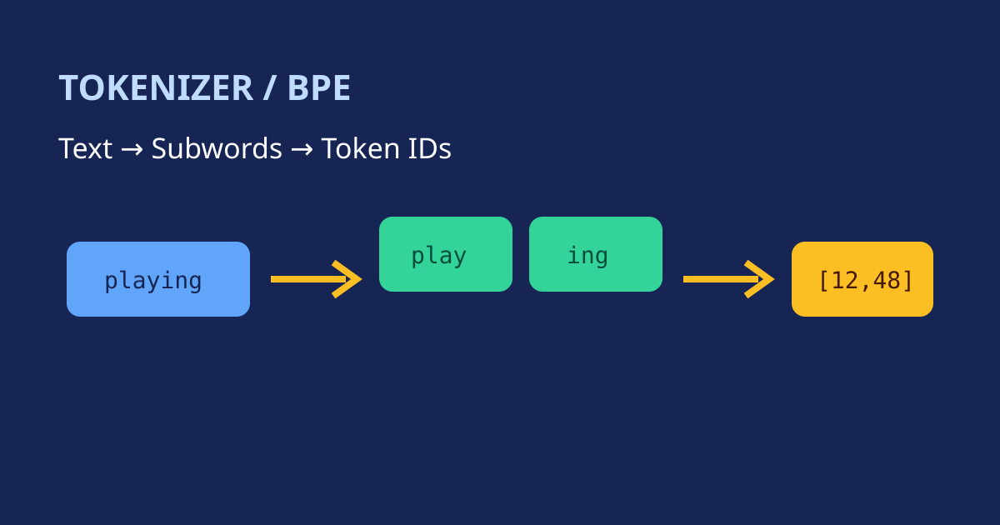

# Unit 35: Tokenizer and BPE Fundamentals

<p class="unit-hero">
  
</p>

> [!NOTE]
> This unit belongs to Chapter 4's **LLM Internals & Model Adaptation (Units 35–36)** track. It explains how an LLM converts text into tokens and token IDs using small BPE examples rather than training a production-scale tokenizer.
>
> - **Prerequisites & timing**: Builds on [Unit 22 (Evolution from LLM to AI Agent)](../unit22_llm_evolution/index.md) and [Unit 23 (LLM API Usage & Prompt Engineering)](../unit23_llm_api/index.md). If you want to understand token counting before RAG chunking, you can read this unit right after Unit 23.
> - **Next steps**: Continue to [Unit 36 (LLM Adaptation with LoRA / QLoRA)](../unit36_lora_qlora/index.md), then move on to the [Chapter 5 Capstones (starting with Unit 37)](../unit37_llm_harness_capstone/index.md).

## 1. Understanding Tokenizers and BPE

> Unit 23 used a model-provided tokenizer (`tiktoken`) to measure token counts. This unit does not fully reproduce that tokenizer; instead, it uses a small implementation to focus on BPE's central idea: merging frequent pairs.

LLMs do not read raw text directly. They split text into small units called **tokens**, then convert those tokens into integer **token IDs**. Subword tokens help represent unknown words, Japanese, and source code without requiring every complete word to be in the vocabulary.

### The basic idea of BPE

Byte Pair Encoding (BPE) starts with characters or bytes and repeatedly merges frequent adjacent pairs to build a vocabulary. Production tokenizers differ in normalization, Unicode handling, special tokens, and training data, so this unit’s toy implementation is for learning—not a drop-in replacement.

The diagram below illustrates the core idea of BPE: starting from characters and merging frequent pairs to build a reusable vocabulary.


Token count affects context length, API cost, and inference work. The same number of characters can produce different token counts across languages and formats, so applications should measure using the tokenizer for the actual model.

The diagram below shows how a tokenizer runs at inference time using a learned vocabulary.


## 2. Implementation Example

The following is a small BPE-like implementation using only the Python standard library.

```python
from collections import Counter


def pair_counts(tokens):
    return Counter(zip(tokens, tokens[1:]))


def merge_pair(tokens, pair):
    merged = []
    i = 0
    while i < len(tokens):
        if i < len(tokens) - 1 and (tokens[i], tokens[i + 1]) == pair:
            merged.append(tokens[i] + tokens[i + 1])
            i += 2
        else:
            merged.append(tokens[i])
            i += 1
    return merged


def train_toy_bpe(words, merges=3):
    tokens = [list(word) + ["</w>"] for word in words]
    for _ in range(merges):
        counts = Counter()
        for word_tokens in tokens:
            counts.update(pair_counts(word_tokens))
        if not counts:
            break
        best_pair, frequency = counts.most_common(1)[0]
        if frequency < 2:
            break
        tokens = [merge_pair(word_tokens, best_pair) for word_tokens in tokens]
        print("merge:", best_pair, "frequency:", frequency)
    return tokens


corpus = ["playing", "played", "player", "playing"]
print(train_toy_bpe(corpus))
```

Real tokenizers also handle normalization, special tokens, Unicode, vocabulary persistence, and unknown inputs.

## 3. Practice

Use the following starter dataset (three English sentences, three Japanese sentences, and three Python snippets) to observe how the number of toy-BPE merges changes the output and how it differs from a production tokenizer (`tiktoken`).

```python
samples = {
    "english": [
        "Tokenizers split text into subword tokens.",
        "Byte pair encoding merges frequent token pairs.",
        "Counting tokens helps estimate context length and cost.",
    ],
    "japanese": [
        "トークナイザーは文章をサブワードのトークンに分割します。",
        "BPEは頻出する文字ペアを順番に結合して語彙を作ります。",
        "トークン数を測定すると、コンテキスト長と料金を見積もれます。",
    ],
    "python": [
        "def count_tokens(tokens):\n    return len(tokens)",
        "def merge_tokens(tokens, pair):\n    return [t for t in tokens if t]",
        "total_tokens = sum(count_tokens(item) for item in batch)",
    ],
}
```

### Steps

1. **Step 1: Compare merge counts (`merges=3` vs. `merges=10`) with `train_toy_bpe`**
   - Using `train_toy_bpe` from Section 2, run `merges=3` and `merges=10` on each category (`english`, `japanese`, and `python`) in `samples`.
   - Split each sentence with `text.split()` before passing the words in, and check how the total token count changes and which subwords emerge.
2. **Step 2: Measure token counts on the same data with a production tokenizer (`tiktoken`)**
   - Using `tiktoken` from Unit 23, measure token counts for the same `samples` with `tiktoken.encoding_for_model("gpt-4o-mini")` (or `tiktoken.get_encoding("o200k_base")`).
   - Compare total character count and total token count side by side for each category.
   - `tiktoken` is usually available in Google Colab; if you get a `ModuleNotFoundError` in an environment where it is not installed, run `%pip install tiktoken` at the top of your cell and retry.
3. **Step 3: Explain three reasons why toy BPE and a production tokenizer produce different results**
   - Compare the outputs from Step 1 and Step 2 and give three concrete mechanism-based reasons why the same text produces very different splits and token counts.

## 4. Answer Key

<details>
<summary>View sample answer</summary>

```python
from collections import Counter


def pair_counts(tokens):
    return Counter(zip(tokens, tokens[1:]))


def merge_pair(tokens, pair):
    merged = []
    i = 0
    while i < len(tokens):
        if i < len(tokens) - 1 and (tokens[i], tokens[i + 1]) == pair:
            merged.append(tokens[i] + tokens[i + 1])
            i += 2
        else:
            merged.append(tokens[i])
            i += 1
    return merged


def train_toy_bpe(words, merges=3, verbose=False):
    tokens = [list(word) + ["</w>"] for word in words]
    for step in range(1, merges + 1):
        counts = Counter()
        for word_tokens in tokens:
            counts.update(pair_counts(word_tokens))
        if not counts:
            break
        best_pair, frequency = counts.most_common(1)[0]
        if frequency < 2:
            break
        tokens = [merge_pair(word_tokens, best_pair) for word_tokens in tokens]
        if verbose:
            print(f"  merge {step}: {best_pair} (freq={frequency})")
    return tokens


samples = {
    "english": [
        "Tokenizers split text into subword tokens.",
        "Byte pair encoding merges frequent token pairs.",
        "Counting tokens helps estimate context length and cost.",
    ],
    "japanese": [
        "トークナイザーは文章をサブワードのトークンに分割します。",
        "BPEは頻出する文字ペアを順番に結合して語彙を作ります。",
        "トークン数を測定すると、コンテキスト長と料金を見積もれます。",
    ],
    "python": [
        "def count_tokens(tokens):\n    return len(tokens)",
        "def merge_tokens(tokens, pair):\n    return [t for t in tokens if t]",
        "total_tokens = sum(count_tokens(item) for item in batch)",
    ],
}

# Step 1: Compare merges=3 and merges=10 with toy BPE
# (Pass verbose=True to train_toy_bpe(...) to inspect each merge step.)
toy_results = {}
print("=== Step 1: toy BPE (merges=3 vs merges=10) ===")
for lang, texts in samples.items():
    words = [word for text in texts for word in text.split()]
    tokens_m3 = train_toy_bpe(words, merges=3)
    tokens_m10 = train_toy_bpe(words, merges=10)
    total_chars = sum(len(text) for text in texts)
    count_m3 = sum(len(word_tokens) for word_tokens in tokens_m3)
    count_m10 = sum(len(word_tokens) for word_tokens in tokens_m10)
    toy_results[lang] = (total_chars, count_m3, count_m10)

    first_word_count = len(texts[0].split())
    print(
        f"[{lang}] chars={total_chars}, "
        f"toy_bpe(merges=3)={count_m3}, toy_bpe(merges=10)={count_m10}"
    )
    print(f"  First sentence split (merges=3):  {tokens_m3[:first_word_count]}")
    print(f"  First sentence split (merges=10): {tokens_m10[:first_word_count]}")

# Step 2: Measure token counts on the same text with a production tokenizer (tiktoken)
print("\n=== Step 2: Comparison with a production tokenizer (tiktoken) ===")
try:
    import tiktoken
except ImportError:
    print(
        "tiktoken is not installed. "
        "Run `%pip install tiktoken` in Colab or your local environment and try again."
    )
    tiktoken = None

if tiktoken is not None:
    try:
        try:
            encoding = tiktoken.encoding_for_model("gpt-4o-mini")
        except KeyError:
            encoding = tiktoken.get_encoding("o200k_base")
    except Exception as exc:
        print(
            "Could not load the tiktoken encoding "
            f"(for example, in an offline environment): {exc}"
        )
        encoding = None

    if encoding is not None:
        print(f"Encoding: {encoding.name}")
        for lang, texts in samples.items():
            total_chars, count_m3, count_m10 = toy_results[lang]
            per_sentence = [len(encoding.encode(text)) for text in texts]
            total_tiktoken = sum(per_sentence)
            chars_per_token = total_chars / total_tiktoken
            print(
                f"[{lang}] chars={total_chars}, "
                f"toy_bpe(3)={count_m3}, toy_bpe(10)={count_m10}, "
                f"tiktoken={total_tiktoken} (per sentence: {per_sentence}, "
                f"approx. {chars_per_token:.2f} chars/token)"
            )
```

### Explanation

- **Merge count vs. token count**: Increasing from `merges=3` to `merges=10` combines frequent strings into longer subwords—such as `oken` → `token` in English, `トー` → `トーク` → `トークン` and `ます。` in Japanese, and `to` → `tok` → `token` → `tokens` and `_tokens(` in Python—which reduces the total token count.
- **Why token count ≠ character count**:
  - In English, frequent words and affixes often merge into a single token, making token count much smaller than character count.
  - In Japanese, many characters use 3 bytes in UTF-8, and kanji or phrases absent from the vocabulary can split into multiple bytes, so the same character count tends to produce more tokens than English.
  - In Python code, splitting depends on indentation spaces, newlines, symbols (`(`, `)`, `:`, `_`), and identifier frequency, so character count alone cannot accurately estimate API cost or context usage.
- **Main reasons toy BPE and production tokenizers differ**:
  1. **Training corpus scale and diversity**: Toy BPE counts pairs only across three local sentences, whereas production tokenizers build subword vocabularies statistically from massive multilingual text and source-code corpora.
  2. **Normalization and pre-tokenization**: Production tokenizers apply regex patterns (and Unicode normalization where needed) before BPE merges to split words, numbers, symbols, and newlines cleanly, whereas toy BPE uses only a naive `split()`.
  3. **UTF-8 byte-level BPE**: Production tokenizers such as `tiktoken` operate on UTF-8 byte sequences rather than characters, allowing them to represent any Unicode character or emoji without unknown (`UNK`) tokens.
  4. **Whitespace and special-token handling**: Production tokenizers include leading spaces and indentation inside tokens so the original text can be reconstructed faithfully, and they manage special tokens such as `<|endoftext|>` (unlike toy BPE's `</w>`).
  5. **Vocabulary size**: Toy BPE performs only a few merges, whereas production encodings such as `o200k_base` have roughly 200,000 tokens, compressing common words and phrases into far fewer tokens.

Token count is not simply proportional to character count. In practice, measure representative English, Japanese, and code inputs with the tokenizer used by your target model to estimate context-window usage and API cost.

</details>
