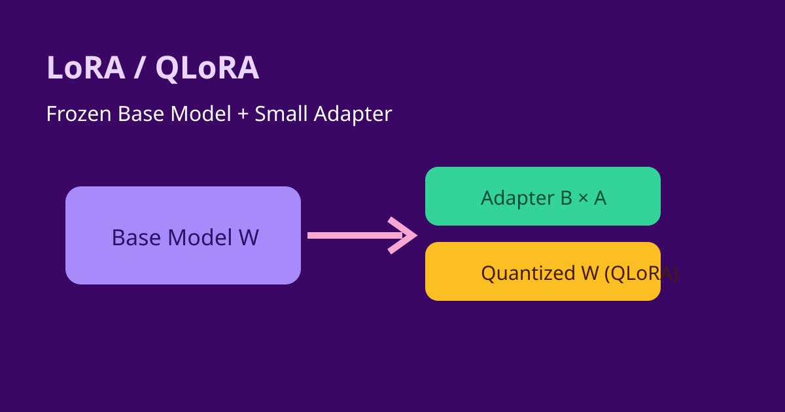

# Unit 36: LLM Adaptation with LoRA / QLoRA

<p class="unit-hero">
  
</p>

> [!NOTE]
> This unit concludes Chapter 4's **LLM Internals & Model Adaptation (Units 35–36)** track. It uses a minimal PyTorch example to illustrate how LoRA adapts a frozen base model with small low-rank matrices and discusses QLoRA design trade-offs.
>
> - **Prerequisites**: Builds on [Unit 15 (Transfer Learning with ResNet)](../unit15_transfer_learning/index.md) and [Units 20](../unit20_attention_transformers/index.md)–[23](../unit23_llm_api/index.md), pairing with [Unit 35 (Tokenizer and BPE Fundamentals)](../unit35_tokenizer_bpe/index.md) to round out LLM internals.
> - **Next steps**: After completing Chapter 4, continue to the [Chapter 5 Capstones (starting with Unit 37)](../unit37_llm_harness_capstone/index.md).

> [!WARNING]
> Do not include personal or secret information in training data. Check model and dataset licenses, GPU cost, and separation of training and evaluation data.

## 1. Understanding Fine-Tuning and LoRA

Fine-tuning adjusts an existing LLM for a task or domain. Updating every parameter can require substantial GPU memory and storage. **LoRA (Low-Rank Adaptation)** freezes the base weights and trains small low-rank matrices instead.

Conceptually, LoRA adds a learned update `ΔW = B × A` to the original linear transformation `W`. It reduces the number of trainable parameters, but it does not automatically solve quality, safety, or licensing concerns.

**QLoRA** combines LoRA with a quantized base model. It may reduce memory requirements, but depends on 4-bit backends, GPU support, and library versions. This unit focuses on the LoRA mechanism and uses QLoRA to discuss design trade-offs.

The diagram below shows the LoRA structure, where a trainable low-rank update `B × A` is added to the frozen base weights `W`.


The diagram below illustrates the workflow of freezing (and optionally quantizing) a base model, attaching a LoRA adapter, and training and evaluating it.


## 2. Implementation Example

The following minimal PyTorch module makes the frozen base and trainable adapter visible. It is not a script for training a full LLM.

```python
import torch
from torch import nn


class LoRALinear(nn.Module):
    def __init__(self, in_features, out_features, rank=2, alpha=1.0):
        super().__init__()
        self.base = nn.Linear(in_features, out_features)
        for parameter in self.base.parameters():
            parameter.requires_grad = False
        self.adapter_a = nn.Parameter(torch.randn(rank, in_features) * 0.01)
        self.adapter_b = nn.Parameter(torch.zeros(out_features, rank))
        self.scale = alpha / rank

    def forward(self, x):
        base_output = self.base(x)
        update = (x @ self.adapter_a.T) @ self.adapter_b.T
        return base_output + self.scale * update


model = LoRALinear(8, 4, rank=2)
trainable = sum(p.numel() for p in model.parameters() if p.requires_grad)
total = sum(p.numel() for p in model.parameters())
print("trainable parameters:", trainable)
print("total parameters:", total)
```

The base weights are frozen; only `adapter_a` and `adapter_b` are trainable. Real LLM projects commonly use PEFT-style libraries and must choose target layers, learning rate, rank, and evaluation procedures.

## 3. Practice

Using `LoRALinear` from Section 2, verify LoRA's parameter reduction and weight-freezing behavior on a small synthetic regression dataset. Start by preparing inputs `X` and targets `y` with the following setup:

```python
import torch
from torch import nn

torch.manual_seed(42)
in_features = 16
out_features = 8
X = torch.randn(64, in_features)
true_weight = torch.randn(in_features, out_features) * 0.5
y = X @ true_weight + 0.1 * torch.randn(64, out_features)
```

Work through the following experiments and questions in order:

1. Loop over `rank in [1, 2, 4]` and print each rank's trainable parameter count, total parameter count, and trainable-parameter ratio compared with a full-parameter `nn.Linear(16, 8)` layer.
2. Use `all(not p.requires_grad for p in model.base.parameters())` to confirm that every base-layer parameter is frozen.
3. Before training, save copies of `model.base.weight` (as well as `adapter_a` and `adapter_b`) with `.detach().clone()`. Pass only trainable parameters to `torch.optim.Adam` and train for 20 steps with `nn.MSELoss()`. Afterward, use `torch.allclose` to verify that `base.weight` is completely unchanged while `adapter_a` and `adapter_b` changed and the loss decreased.
4. For QLoRA, explain its memory-reduction benefit from quantization alongside its trade-offs in accuracy, training speed, and GPU/library dependencies.

For real training, separate training and evaluation data and record the base model, adapter, tokenizer, training configuration, and evaluation results.

## 4. Answer Key

<details>
<summary>View sample answer</summary>

```python
import torch
from torch import nn


class LoRALinear(nn.Module):
    def __init__(self, in_features, out_features, rank=2, alpha=1.0):
        super().__init__()
        self.base = nn.Linear(in_features, out_features)
        for parameter in self.base.parameters():
            parameter.requires_grad = False
        self.adapter_a = nn.Parameter(torch.randn(rank, in_features) * 0.01)
        self.adapter_b = nn.Parameter(torch.zeros(out_features, rank))
        self.scale = alpha / rank

    def forward(self, x):
        base_output = self.base(x)
        update = (x @ self.adapter_a.T) @ self.adapter_b.T
        return base_output + self.scale * update


# Fix random seed for reproducibility and create a small synthetic regression dataset
torch.manual_seed(42)
in_features = 16
out_features = 8
X = torch.randn(64, in_features)
true_weight = torch.randn(in_features, out_features) * 0.5
y = X @ true_weight + 0.1 * torch.randn(64, out_features)

# Step 1: Compare parameter counts across ranks with full-parameter nn.Linear
full_layer = nn.Linear(in_features, out_features)
full_trainable = sum(p.numel() for p in full_layer.parameters() if p.requires_grad)
print(
    f"Full nn.Linear({in_features}, {out_features}): "
    f"trainable={full_trainable} (100.0%)"
)

for rank in [1, 2, 4]:
    lora_layer = LoRALinear(in_features, out_features, rank=rank, alpha=float(rank))
    trainable = sum(p.numel() for p in lora_layer.parameters() if p.requires_grad)
    total = sum(p.numel() for p in lora_layer.parameters())
    trainable_pct = trainable / total * 100
    vs_full_pct = trainable / full_trainable * 100
    print(
        f"LoRA rank={rank}: trainable={trainable}, total={total}, "
        f"trainable/total={trainable_pct:.1f}%, vs_full={vs_full_pct:.1f}%"
    )

# Step 2: Confirm all base-layer parameters are frozen
model = LoRALinear(in_features, out_features, rank=4, alpha=4.0)
base_all_frozen = all(not p.requires_grad for p in model.base.parameters())
print("base parameters all frozen:", base_all_frozen)
assert base_all_frozen

# Step 3: Verify weight changes and loss reduction after training
base_weight_before = model.base.weight.detach().clone()
adapter_a_before = model.adapter_a.detach().clone()
adapter_b_before = model.adapter_b.detach().clone()

criterion = nn.MSELoss()
trainable_params = [p for p in model.parameters() if p.requires_grad]
optimizer = torch.optim.Adam(trainable_params, lr=0.05)

with torch.no_grad():
    initial_loss = criterion(model(X), y).item()

for step in range(20):
    optimizer.zero_grad()
    predictions = model(X)
    loss = criterion(predictions, y)
    loss.backward()
    optimizer.step()

with torch.no_grad():
    final_loss = criterion(model(X), y).item()

base_unchanged = torch.allclose(base_weight_before, model.base.weight)
adapter_a_changed = not torch.allclose(adapter_a_before, model.adapter_a)
adapter_b_changed = not torch.allclose(adapter_b_before, model.adapter_b)

print(f"initial_loss={initial_loss:.4f} -> final_loss={final_loss:.4f}")
print("base.weight unchanged:", base_unchanged)
print("adapter_a changed:", adapter_a_changed)
print("adapter_b changed:", adapter_b_changed)

assert base_unchanged
assert adapter_a_changed
assert adapter_b_changed
assert final_loss < initial_loss
```

### Explanation

- **Rank (`rank`) trade-offs**: A `LoRALinear(16, 8)` layer has `(16 + 8) × rank` trainable parameters—24, 48, and 96 for `rank=1, 2, 4`, respectively (compared with 128 weights + 8 biases = 136 parameters for a full-parameter `nn.Linear(16, 8)` layer). Increasing `rank` raises expressive capacity, but also increases trainable parameters, memory usage, training time, and overfitting risk. Even though the reduction looks modest on this tiny layer, in real LLMs (such as 4096 × 4096 layers), low-rank adaptation keeps trainable parameters under 1% of the original layer.
- **Why `adapter_b` is zero-initialized**: Initializing `adapter_a` with small random values and `adapter_b` with zeros ensures that at step 0, `ΔW = B × A = 0`. As a result, the model's initial output matches the pretrained base model exactly, letting adaptation begin stably without disrupting existing knowledge (on step 1 `adapter_b` updates, and from step 2 onward gradients also flow into `adapter_a` so both matrices update).
- **QLoRA benefits and trade-offs**: QLoRA does not mean every LoRA model is automatically quantized; rather, it freezes a quantized (e.g., 4-bit) base model and trains LoRA adapters on top. Because base weights consume far less GPU memory, larger models become feasible on limited VRAM. The trade-offs are slower training from on-the-fly dequantization during compute, potential accuracy impact from quantization error, and tighter dependencies on supported quantization libraries (such as `bitsandbytes`) and GPU/CUDA environments.

</details>
