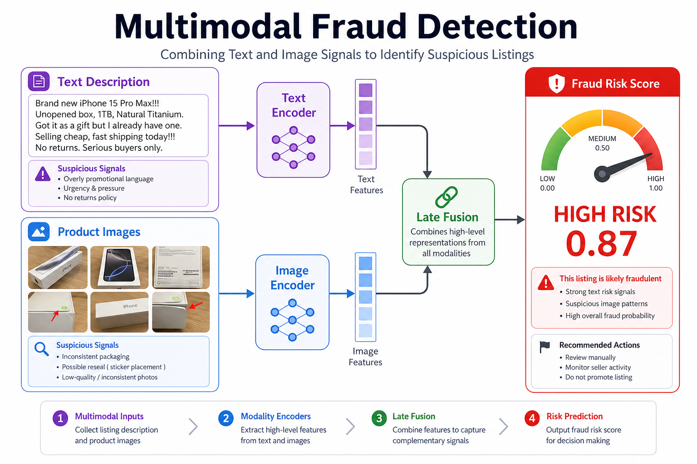
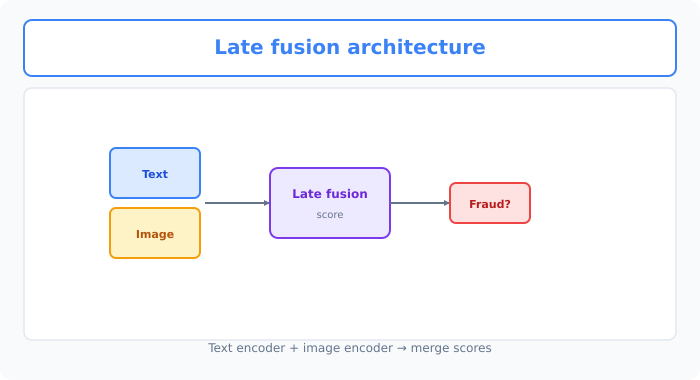
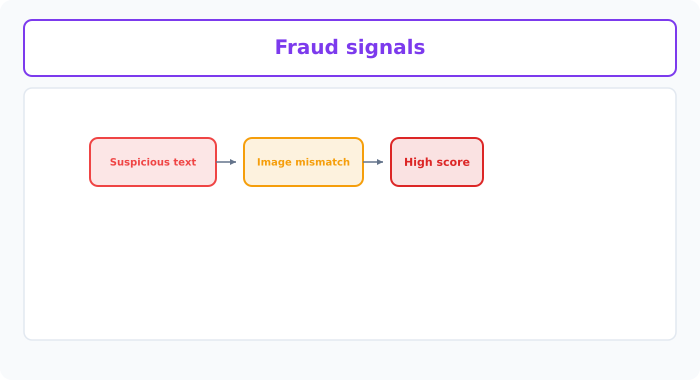

# Unit 38: Multimodal Fraud Detection System

<p class="unit-hero">
  
</p>

## 1. Understanding Multimodal Fraud Detection

In Units 1–8 you learned models for tabular data (numeric and categorical). In Units 10–16 you covered images; in Units 17–21, natural language (text).

However, for one of the hardest business challenges—**fraud detection (fraudulent transactions, counterfeit listings, unauthorized logins, etc.)**—a single data source cannot outsmart professional fraudsters.

- **Tabular data alone**: If transaction amount and frequency look normal, fraud slips through.
- **Text alone**: If listing descriptions look plausible, you cannot detect scam products.
- **Images alone**: If product photos are convincingly forged, photos alone are insufficient.

In practice, you can fuse **multiple modalities (data types)** in a model to capture signals that are difficult to observe from a single modality alone. Because combining modalities does not automatically guarantee higher accuracy or fairness, you must evaluate missing modalities, false positives, and explainability as well.

### Two Major Modal Fusion Approaches

There are two opposing architectural philosophies for integrating different data types:

| Fusion Approach                  | Characteristics & Mechanism                                                                                                                                                   | Pros & Cons                                                                                                                                                                                                    |
| :------------------------------- | :---------------------------------------------------------------------------------------------------------------------------------------------------------------------------- | :------------------------------------------------------------------------------------------------------------------------------------------------------------------------------------------------------------- |
| **Early Fusion (Feature-level)** | Concatenate intermediate feature vectors from image models, text embeddings, and tabular data **before prediction** and train one large neural network jointly.               | **Pros**: Model learns deep cross-feature synergy (e.g., specific image pattern plus suspicious wording).<br>**Cons**: Different dimensionalities require delicate learning-rate tuning; prone to overfitting. |
| **Late Fusion (Decision-level)** | Train tabular (XGBoost), text (NLP), and image (CNN or RandomForest) models **separately**, then **combine prediction probabilities** at the final stage with a meta-learner. | **Pros**: Tune each model independently; very stable and robust.<br>**Cons**: Harder to capture real-time interaction between features.                                                                        |

The diagram below illustrates a late-fusion architecture that combines scores from **Text and Image encoders**. While the text and code in this unit handle three modalities—tabular, text, and image—the diagram omits the tabular modality for visual clarity.



---

The diagram below shows how **contradictory signals** between text and images raise the fraud score.



> [!TIP]
> **Fraud Detection Is a Classic Imbalanced-Data Problem**
> The synthetic dataset in this unit uses a fixed random seed so that roughly 15% of listings are fraudulent (the exact ratio varies slightly if you change the sample size or generation logic). In real-world fraud detection, fraud often accounts for less than 1% of all events. As you learned in Unit 2, predicting "legitimate" for every case on such imbalanced data still achieves 99% accuracy—so you must **evaluate with Recall, Precision, and F1 rather than accuracy**. On the modeling side, standard techniques include `class_weight="balanced"` (penalizing minority-class errors more heavily) and tuning the decision threshold (used in this unit's sample solution).

## 2. Implementation Example - Multimodal Baseline

> **Colab setup:** The current Colab runtime includes NumPy, pandas, scikit-learn, and XGBoost, so no additional installation is required.

First, run a **minimal early-fusion baseline** that concatenates all three feature types into a single input row. For simplicity, this example uses pre-extracted feature vectors rather than training actual image or text encoders; it is instructional code meant for comparing fusion strategies.

```python
import numpy as np
from sklearn.linear_model import LogisticRegression
from sklearn.metrics import classification_report
from sklearn.model_selection import train_test_split
from sklearn.pipeline import make_pipeline
from sklearn.preprocessing import StandardScaler

np.random.seed(42)
n_samples = 200
table_features = np.random.randn(n_samples, 3)
text_features = np.random.randn(n_samples, 16)
image_features = np.random.randn(n_samples, 32)
y_labels = (np.random.rand(n_samples) < 0.15).astype(int)
fraud_idx = y_labels == 1
table_features[fraud_idx, 0] += 1.5
text_features[fraud_idx, :4] += 1.2
image_features[fraud_idx, :6] += 0.8

X_early = np.hstack([table_features, text_features, image_features])
X_train, X_test, y_train, y_test = train_test_split(
    X_early, y_labels, test_size=0.2, random_state=42, stratify=y_labels
)

baseline = make_pipeline(
    StandardScaler(),
    LogisticRegression(C=0.1, class_weight="balanced", max_iter=2000),
)
baseline.fit(X_train, y_train)
pred = baseline.predict(X_test)
print(classification_report(y_test, pred, zero_division=0))
```

Record this baseline's Recall, Precision, and F1 before comparing it against late fusion and threshold tuning. Do not choose a production model from a single small split alone—check multiple splits or cross-validation alongside the business costs of false positives and missed fraud.

## 3. Practice — 🧠 Design and Decide Multimodal Fraud Detection

Start by running the early-fusion baseline from the implementation example. Next, compare and decide **whether to apply early fusion (neural network concatenation) or late fusion (stacking)** and how to detect fraud based on data characteristics and overfitting risk. Finally, summarize your results and constraints in a short design note.

**Assignment Requirements**

Use the following simulation dataset initialization code for fraud detection in a flea-market app.

```python
import numpy as np
import pandas as pd

# 1. Sample count
n_samples = 200

# 2. Tabular data (transaction amount, past violation count, days since account creation)
np.random.seed(42)
table_features = np.random.randn(n_samples, 3)

# 3. Text data (description embedding vectors — 16 dimensions)
text_features = np.random.randn(n_samples, 16)

# 4. Image data (product feature vectors — 32 dimensions)
image_features = np.random.randn(n_samples, 32)

# 5. Ground truth labels (0: legitimate listing, 1: fraudulent listing)
# Determine fraudulent listings (~15% of total) first, then intentionally shift their features
# so that features and labels share a real, learnable correlation
y_labels = (np.random.rand(n_samples) < 0.15).astype(int)
fraud_idx = y_labels == 1

# Fraudulent listings tend to have higher amounts, more past violations, and newer accounts
table_features[fraud_idx, 0] += 1.5   # Higher-than-average transaction amount
table_features[fraud_idx, 1] += 2.0   # More past violations
table_features[fraud_idx, 2] -= 1.0   # Shorter account age

# Descriptions and product photos of fraudulent listings follow distinct feature patterns
text_features[fraud_idx, :4] += 1.2   # Shifted text dimensions for suspicious boilerplate
image_features[fraud_idx, :6] += 0.8  # Shifted image dimensions for counterfeit visual patterns
```

**Your Mission: Multimodal Fusion Architecture Design Decision**

Design a fraud detection classifier that integrates **tabular (3D), text (16D), and image (32D)** features.

---

**Design Decision Notes to Record in Code Comments**

1. **Fusion method selection rationale**:
   - Explain why you chose early or late fusion from sample size (200) and feature dimensions.
2. **Model implementation and overfitting mitigation**:
   - Implement the pipeline for your chosen approach.
   - With only 200 samples, describe regularization (L2, Dropout, tree depth limits, etc.) to avoid memorizing noise and misclassifying normal amount spikes as fraud.
3. **Quantitative evaluation**:
   - Split validation data appropriately (or use cross-validation) and report **Recall**, **Precision**, and F1—metrics critical for fraud detection.
4. **Final adoption decision**:
   - **State the model configuration you deploy to production and why.**

## 4. Answer Key — 💡 Professional Multimodal Design Guidelines

<details>
<summary>View sample solution (click to expand)</summary>

### 💡 Multimodal Decision Notes as an AI Engineer

In practice, during early phases with small datasets, high-capacity early-fusion models can easily overfit. However, which fusion approach performs best depends on data size, feature extractors, regularization, and evaluation design—so always decide by comparing against baselines.

#### Fraud Detection Design Decision Matrix

| Evaluation Axis    | Approach A (Early Fusion / NN)                                                                    | Approach B (Late Fusion / Stacking)                                                                                  | Design Decision Point                                                                   |
| :----------------- | :------------------------------------------------------------------------------------------------ | :------------------------------------------------------------------------------------------------------------------- | :-------------------------------------------------------------------------------------- |
| **Small-data fit** | A 51-dimensional input in one NN on 200 samples requires careful overfitting controls.            | Combining pre-extracted features with simple predictors can be easier to evaluate, though results depend on data.    | Compare early fusion, late fusion, and single-modality baselines with cross-validation. |
| **Explainability** | **Low**. Features mix in hidden layers; hard to explain "why this listing was flagged."           | **High**. Track each factor: "image score normal but text score and violation count abnormal."                       | Explainability is decisive for seller appeals and audit logs to patrol teams.           |

---

### Robust Fraud Detection via Late Fusion (Stacking)

```python
import numpy as np
import pandas as pd
from sklearn.model_selection import train_test_split, cross_val_predict
from sklearn.linear_model import LogisticRegression
from sklearn.ensemble import RandomForestClassifier
from sklearn.metrics import classification_report, f1_score
import xgboost as xgb

# 1. Decision:
# "With only 200 samples, a high-capacity early-fusion NN is prone to overfitting."
# "Therefore we use late fusion: separate models per modality, combined by a meta-learner (LogisticRegression)."
# "Apply strong L2 regularization (C=0.1) on the meta-learner and tune threshold for Recall to reduce missed fraud."

# Data split (80% train, 20% validation)
# Fit simulation features to models for simplicity;
# stratify=y_labels preserves the ~15% fraud ratio in both train and validation splits
X_table_tr, X_table_val, X_text_tr, X_text_val, X_img_tr, X_img_val, y_train, y_val = train_test_split(
    table_features, text_features, image_features, y_labels,
    test_size=0.2, random_state=42, stratify=y_labels
)

# --- Step 1: Train per-modality sub-models ---
# (These fitted sub-models predict on the validation split;
#  meta-learner training uses out-of-fold predictions from Step 2.)
# Tabular: XGBoost with max_depth=3 to limit overfitting
model_table = xgb.XGBClassifier(max_depth=3, n_estimators=30, random_state=42)
model_table.fit(X_table_tr, y_train)

# Text: Logistic regression
model_text = LogisticRegression(C=1.0, random_state=42)
model_text.fit(X_text_tr, y_train)

# Image: Random forest
model_img = RandomForestClassifier(max_depth=4, n_estimators=30, random_state=42)
model_img.fit(X_img_tr, y_train)

# --- Step 2: Extract prediction probabilities (Decision) ---
# [Key leakage-prevention point]
# If you feed in-sample training probabilities from already-fitted sub-models directly to the
# meta-learner, it trains on overly confident, memorized probabilities (near 0.0 or 1.0) and
# degrades on validation data (classic stacking leakage).
# Instead, use out-of-fold predictions via cross_val_predict so each training sample's probability
# comes from a model that did not train on that sample (standard stacking practice).
pred_prob_table_tr = cross_val_predict(
    xgb.XGBClassifier(max_depth=3, n_estimators=30, random_state=42),
    X_table_tr, y_train, cv=5, method="predict_proba")[:, 1]
pred_prob_text_tr = cross_val_predict(
    LogisticRegression(C=1.0, random_state=42),
    X_text_tr, y_train, cv=5, method="predict_proba")[:, 1]
pred_prob_img_tr = cross_val_predict(
    RandomForestClassifier(max_depth=4, n_estimators=30, random_state=42),
    X_img_tr, y_train, cv=5, method="predict_proba")[:, 1]

# Stack three probabilities as meta-features (late stacking, not early fusion)
meta_features_train = np.column_stack((pred_prob_table_tr, pred_prob_text_tr, pred_prob_img_tr))

# --- Step 3: Train meta-learner ---
# Logistic regression with strong L2 (C=0.1) to learn score importance
meta_learner = LogisticRegression(C=0.1, random_state=42)
meta_learner.fit(meta_features_train, y_train)

# --- Step 4: Validation evaluation ---
pred_prob_table_val = model_table.predict_proba(X_table_val)[:, 1]
pred_prob_text_val = model_text.predict_proba(X_text_val)[:, 1]
pred_prob_img_val = model_img.predict_proba(X_img_val)[:, 1]

meta_features_val = np.column_stack((pred_prob_table_val, pred_prob_text_val, pred_prob_img_val))

# Final prediction from meta-learner
final_pred_probs = meta_learner.predict_proba(meta_features_val)[:, 1]

# Business decision: lower threshold from 0.5 to 0.35 to improve Recall and reduce missed fraud
final_preds = (final_pred_probs >= 0.35).astype(int)

print("--- Multimodal Fraud Detection Evaluation Report ---")
print(classification_report(y_val, final_preds))
```

### 💡 Final Production Adoption Decision

- **Final decision**:
  - **Deploy late fusion (Late Fusion / meta-stacking) as the production model.**
  - **Rationale**:
    1. **Overfitting control and verification**: On this small synthetic dataset, regularized late fusion is a strong candidate. Because generalization advantage on unseen data is never automatic, verify by comparing F1, Recall, and Precision under the same split conditions.
    2. **Easier per-domain debugging**: When fraud is flagged, you can separate whether the image model (RandomForest in this unit) or XGBoost account behavior produced a high fraud probability. This makes false-positive recovery and rule tuning easier, while CNN-based image encoders remain a practical alternative in production.
    3. **Recall protection via threshold tuning**: Output probabilities from the meta-learner allow flexible thresholds (e.g., `0.35`) aligned with business risk (acceptable fraud loss), controlling missed fraud listings.

</details>
