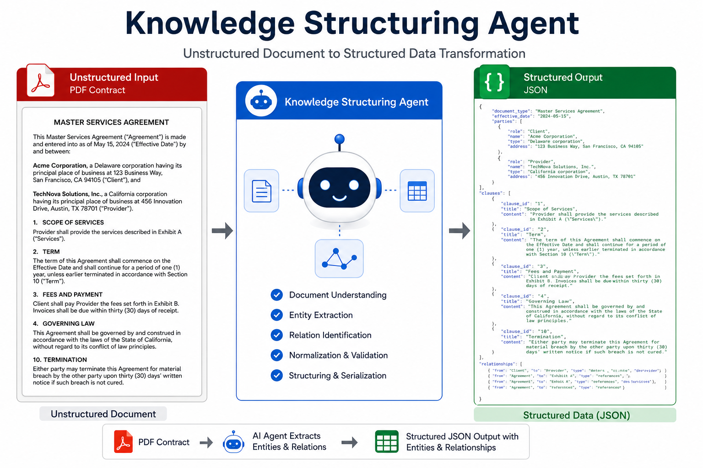
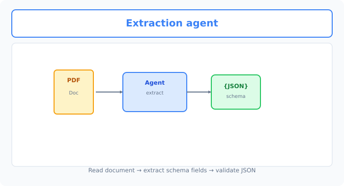
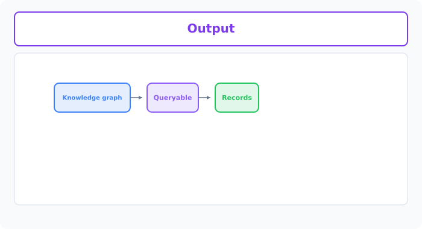

# Unit 39: Autonomous Knowledge Extraction & Structuring Agent

<p class="unit-hero">
  
</p>

## 1. Understanding Knowledge Extraction and Structuring from Unstructured Data

In Unit 26 you learned the RAG-focused framework `LlamaIndex`. In Unit 31 you learned `smolagents` (CodeAgent), which autonomously writes and executes Python code.

One of the most powerful production use cases for generative AI is a **structured extraction pipeline** that **automatically pulls required business information (contract dates, amounts, penalty clauses, complaint categories, etc.) from large volumes of unstructured enterprise data (free-form PDFs, scanned images, contracts, emails) and converts it into clean JSON (structured data) ready for database storage**.

### Why a Simple LLM Call Is Not Enough for Production

Prompting "extract the amount as JSON from this contract" alone is not production-ready:

1. **Schema violations**: Wrong JSON keys or broken date formats (`YYYY-MM-DD`) cause immediate DB insertion failures.
2. **Hallucination (fabricated information)**: The LLM may invent amounts not in the contract.
3. **Long document limits (Token Limit)**: A single PDF may be fine, but 100-page documents spike cost and cause missed information (Lost in the Middle).

### Autonomous Structuring Agent Architecture

The professional architecture combines **LlamaIndex pinpoint retrieval (Retrieve)** with **smolagents (Code Agent) Python execution and self-correction loops**.

1. **Retrieve**: Use `LlamaIndex` to semantically find pages about "penalties and payment terms" in a large contract.
2. **Extraction**: Pass extracted text to the LLM and output structured JSON based on a Pydantic schema.
3. **Validation & Correction**:
   - Strictly validate output JSON against the schema (Pydantic model) in code.
   - On validation errors, the agent (`smolagents`) **parses error logs, fixes code or prompts on the spot, and retries until valid JSON is produced (Self-Correction)**.

Note that this unit's implementation focuses on **Extraction** and **Validation & Correction**. The initial **Retrieve** stage—narrowing large document collections down to relevant pages via semantic search—can be attached directly upstream using `LlamaIndex` from Unit 26. Here, assuming retrieved raw text is already available, we build a pipeline that produces schema-compliant candidate JSON and routes unverifiable values to human review instead of storing them.

The diagram below shows the knowledge structuring pipeline from **PDF → Agent Extraction → JSON Schema**.



---

The diagram below illustrates how structured data is **stored in a database and used as queryable records** for search and aggregation (connecting structured records through relationships can further extend this into a knowledge graph).



## 2. Implementation Example - Minimal Schema Validation Pipeline

> **Colab setup:** The current Colab runtime includes Pydantic. For the later self-correction agent using `OpenAIServerModel`, add only the smolagents OpenAI extra.
>
> ```python
> %pip install "smolagents[openai]"
> ```

Before calling an LLM, run a minimal example that validates structured candidate data with Pydantic. This checks JSON shape, types, and business-rule ranges, but it does not guarantee that the extracted values are actually present in or faithful to the source text. In production, add source citations, field-level evidence, confidence signals, and human review.

```python
from datetime import date
from pydantic import BaseModel, ValidationError, field_validator

class ContractRecord(BaseModel):
    client_name: str
    vendor_name: str
    agreement_date: date
    total_budget_yen: int
    duration_months: int

    @field_validator("total_budget_yen", "duration_months")
    @classmethod
    def must_be_positive(cls, value):
        if value <= 0:
            raise ValueError("Value must be positive")
        return value

candidate = {
    "client_name": "AI Technology Inc.",
    "vendor_name": "Mirai Systems Inc.",
    "agreement_date": "2026-05-12",
    "total_budget_yen": 12_000_000,
    "duration_months": 24,
}

try:
    record = ContractRecord.model_validate(candidate)
    print(record.model_dump(mode="json"))
except ValidationError as error:
    print("Do not store input; route to human review:", error)
```

After running this example, intentionally break the date format or budget value to verify that validation catches it. In the next practice section, you will design an extractor that produces this candidate data from messy source text.

> [!TIP]
> **Production Note: Dividing Responsibilities Between Native Structured Outputs and Pydantic Validation**
> Native **Structured Outputs** in APIs such as OpenAI's (`response_format=YourPydanticModel` with `client.beta.chat.completions.parse`, or `text_format=YourPydanticModel` with `client.responses.parse` in the Responses API) enforce a Pydantic schema directly during decoding, preventing JSON syntax errors, missing keys, and type mismatches before validation even runs. However, Structured Outputs only guarantee the structure of the output—**business-rule validation** like `field_validator` above (e.g., checking that budget and duration are positive), **source grounding** against the original document, and **human escalation** for unverifiable values remain essential in production pipelines.

## 3. Practice — 🧠 Design and Decide Your Knowledge Extraction Pipeline

Start by breaking the schema validation in the implementation example to see which inputs get rejected. Next, design **how to combine LlamaIndex retrieval results with an extractor, validator, and optional self-correction loop**, and record in your design notes the conditions for routing unverifiable values to human review.

**Assignment Requirements**

Use the following "raw data (messy contract report text)" as initialization code and build a system that extracts contract information and generates **validated candidate data conforming to the specified JSON schema**. Do not force-store values that cannot be verified—route them to human review.

```python
# 1. Audit target "messy raw data"
dirty_contract_text = """
[Business Partnership Agreement]
This agreement is entered into between AI Technology Inc. (Party A) and Mirai Systems Inc. (Party B).
Agreement date: May 12, 2026.
The total project budget is twelve million yen (excluding tax), to be paid by Party A to Party B in monthly installments.
Payment is due on the last day of each month.
The agreement term is two full years (24 months) from the agreement date.
"""

# 2. Strict JSON schema (Pydantic model)
from pydantic import BaseModel, Field, field_validator
from datetime import date

class ContractSchema(BaseModel):
    client_name: str = Field(description="Party A (client) company name, including legal suffix such as Inc.")
    vendor_name: str = Field(description="Party B (vendor) company name.")
    agreement_date: date = Field(description="Contract agreement date. Must be a date in YYYY-MM-DD format.")
    total_budget_yen: int = Field(description="Total budget in yen. Extract numeric value from text and convert to int. Exclude tax labels.")
    duration_months: int = Field(description="Contract duration in months. Must be an integer.")

    # Business-rule validation via field_validator: even if types match, reject non-positive amounts or durations as extraction errors
    @field_validator("total_budget_yen", "duration_months")
    @classmethod
    def must_be_positive(cls, v: int) -> int:
        if v <= 0:
            raise ValueError("Budget and contract duration must be positive integers")
        return v
```

**Your Mission: Robust Extraction & Self-Correction Agent Design**

Build an agent system that takes the messy text above as input and **automatically generates, validates, and self-corrects** JSON that passes `ContractSchema` validation.

---

**Design Decision Notes to Record in Code Comments**

1. **JSON schema compliance approach**:
   - Beyond "output JSON," describe how you coordinate agents (`smolagents` or program validators) to detect and auto-fix schema violations and date parse errors.
2. **Robust numeric and date conversion design**:
   - Describe your design (Few-Shot prompts, Python interpreter, etc.) to reliably convert written amounts like `"twelve million yen"` to integer `12000000` and `"May 12, 2026"` to date `2026-05-12`.
3. **Final adoption decision**:
   - **State the agent evaluation pipeline you deliver to the enterprise and why.**

## 4. Answer Key — 💡 Professional Structured Data Extraction Design

<details>
<summary>View sample solution (click to expand)</summary>

### 💡 Knowledge Extraction Decision Notes as an AI Engineer

In production structured extraction, validate LLM outputs in code so malformed data never flows downstream. Because schema validation alone cannot guarantee semantic fidelity to the source document, combine it with source citations, confidence checks, re-verification, and human escalation.

#### Structured Extraction Design Decision Matrix

| Evaluation Axis                        | Approach A (Prompt-only JSON output)                           | Approach B (Validator + Self-Correction Agent)                                                | Design Decision Point                                                                      |
| :------------------------------------- | :------------------------------------------------------------- | :-------------------------------------------------------------------------------------------- | :----------------------------------------------------------------------------------------- |
| **Schema compliance**                  | Parse errors can occur from formatting drift or missing keys.  | Validators and retries reduce format errors, though bounded retries cannot guarantee success. | Measure format and semantic errors separately; on failure, route to human review, not DB.  |
| **Written numerals & irregular dates** | Relying solely on LLM extraction risks conversion errors.      | Combine explicit conversion functions, tests, validators, and targeted LLM retries as needed. | Do not delegate every conversion to the agent—prefer deterministic processing where valid. |

---

### Structured Extraction with Validator & Self-Correction Agent (smolagents)

````python
import os
import json
import re
from datetime import date
from pydantic import BaseModel, Field, ValidationError, field_validator
from smolagents import CodeAgent, OpenAIServerModel

# 1. Decision:
# "In healthcare, finance, and enterprise DB integration, format errors causing system downtime are critical."
# "Therefore we adopt strict Pydantic type validation (dates, integers) and smolagents CodeAgent with auto-fix on errors."
# "Ambiguous expressions like 'twelve million yen' are handled with explicit parsing logic and schema validation."

model = OpenAIServerModel(
    model_id="gpt-4o-mini",
    api_key=os.environ.get("OPENAI_API_KEY")
)

# 2. Pydantic schema definition
class ContractSchema(BaseModel):
    client_name: str
    vendor_name: str
    agreement_date: date  # YYYY-MM-DD
    total_budget_yen: int # Parsed and validated integer; store source evidence separately
    duration_months: int  # Integer

    # Business-rule validation via field_validator: budget and duration must be positive
    @field_validator("total_budget_yen", "duration_months")
    @classmethod
    def must_be_positive(cls, v: int) -> int:
        if v <= 0:
            raise ValueError("Budget and contract duration must be positive integers")
        return v

# 3. Agent with built-in self-correction loop
agent = CodeAgent(tools=[], model=model, add_base_tools=True)
# Note: CodeAgent executes generated code, so never run it directly on real data or in production.
# In production, run inside an isolated sandbox with restricted network, filesystem, and secrets,
# grant least-privilege tools, and enforce pre/post execution audit logs and human approval.

# 4. Agent instruction and execution
# Audit order: generate JSON matching ContractSchema fields; fix errors if any
task_instruction = f"""
Extract contract information from the [Raw Data] below and output ONLY JSON text that matches the [JSON Schema]. Do not guess values that cannot be determined from the text; return an error instead.

[Raw Data]:
{dirty_contract_text}

[JSON Schema]:
- "client_name": Party A (client) legal name (string)
- "vendor_name": Party B (vendor) legal name (string)
- "agreement_date": Agreement date as 'YYYY-MM-DD' date string (string)
- "total_budget_yen": Total budget in yen. Convert written amounts like "twelve million yen" to integer 12000000.
- "duration_months": Contract duration in months. Two full years must become integer 24.

Output a pure JSON object only. No extra explanation or JSON markdown decoration.
"""

# --- Step 5: Validation + Self-Correction Loop ---
# On validation failure, feed the full error message back to the agent and automatically
# retry agent.run (up to MAX_RETRIES times) until valid JSON is obtained.
MAX_RETRIES = 3
validated_contract = None
current_task = task_instruction

print("--- Autonomous Knowledge Extraction Agent Starting ---")
for attempt in range(1, MAX_RETRIES + 1):
    print(f"\n--- Extraction attempt {attempt}/{MAX_RETRIES} ---")
    raw_output = agent.run(current_task)
    try:
        # Clean markdown decoration if present
        cleaned_json = str(raw_output).strip()
        # Remove only Markdown JSON code fences returned by the LLM.
        cleaned_json = re.sub(r"^```(?:json)?\s*", "", cleaned_json, flags=re.IGNORECASE)
        cleaned_json = re.sub(r"\s*```$", "", cleaned_json)
        data_dict = json.loads(cleaned_json)

        # Pydantic type and range validation (semantic fidelity to source must be verified separately)
        validated_contract = ContractSchema(**data_dict)

        print("\n✅ Validation passed! Structured knowledge extraction succeeded:")
        print(validated_contract.model_dump_json(indent=2))
        break

    except (json.JSONDecodeError, ValidationError) as e:
        print("❌ Validation error detected. Feeding error details back to the agent for retry...")
        # Feed the full error message back and request regenerated, corrected JSON
        current_task = f"""{task_instruction}

[Your Previous Output]:
{raw_output}

[Validation Error for Previous Output]:
{e}

Review the error above and output only the corrected JSON. If validation still cannot be satisfied, return an error instead of guessing.
"""

if validated_contract is None:
    print(f"\n🚨 Could not obtain valid JSON after {MAX_RETRIES} attempts. Escalating to a human operator.")
````

### 💡 Final Production Adoption Decision

- **Final decision**:
  - **Adopt Approach B (Pydantic validator + self-correcting CodeAgent) for the production knowledge extraction pipeline.**
  - **Rationale**:
    1. **Improved system stability**: Pydantic acts as a gate that keeps invalid types or out-of-range values from flowing downstream. When retries reach their limit, refusing to store and escalating to a human contains fault propagation—though it does not guarantee correct extracted content or zero failures.
    2. **Preferring deterministic conversions**: Perform written-numeral and date conversions with tested, explicit Python functions wherever possible, limiting the agent to candidate extraction and error correction on ambiguous cases. Attach source evidence to extracted values and evaluate semantic accuracy separately.

</details>
